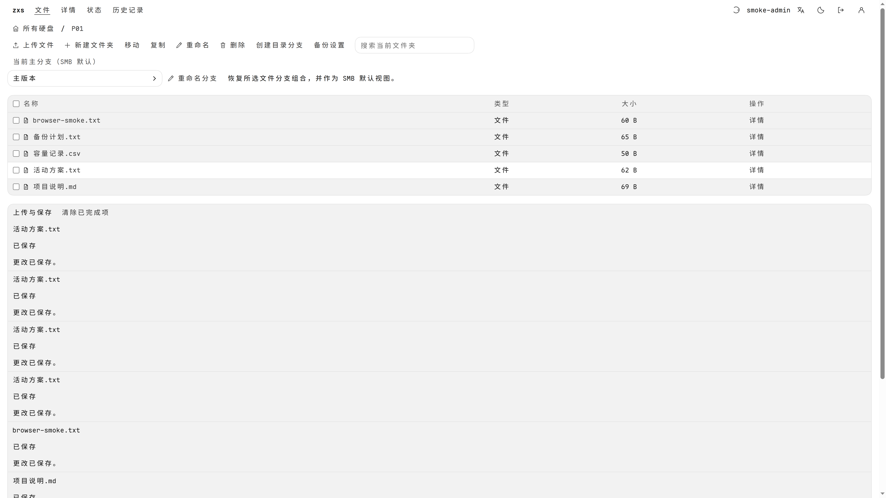

# ZXS 文件存储系统

ZXS 是面向独立硬盘管理的文件存储项目，由一台 Linux amd64 服务端统一管理文件、历史版本和分层备份，提供 Web 网页与独立 SMB 两种用户访问入口，保留服务启动和运维 CLI。

*真实运行截图：独立开发池中的合成测试数据，展示文件上传后的中文 Web 界面。*

## 核心功能

- 文件管理：按磁盘浏览文件和目录，支持上传、下载、移动、改名及操作历史查看。
- 版本与分支：内容写入形成独立完整版本；文件分支先引用冻结父版本，首次写入才保存自己的内容。目录分支组合文件分支，并保留不可变目录历史。
- 合并与标签：显式选择文件分支的合并结果与归属，为版本节点添加可继承的标签。
- 备份与恢复：按用户指定的盘位和逐级来源保存完整副本，提供完整性校验、历史内容清除和离线恢复工具。

## 平台与架构

业务核心和 Web 界面使用 Rust 实现。浏览器通过 WASM 界面和 HTTPS 业务 API 访问服务；SMB 通过独立的 Samba → 本机桥接接入同一存储核心。桌面和移动设备使用浏览器或系统 SMB 客户端；项目不再提供原生 App、WebView 宿主或 App 安装包。

服务端、Samba VFS 和原生构建宿主仅支持 Linux amd64（64 位 x86_64）；当前登记和验收目标为 `x86_64-unknown-linux-gnu`。浏览器产物保留 `wasm32-unknown-unknown`。其他 Linux amd64 ABI 的必要共享实现保留为未验收预留，不代表已经通过构建或运行验收。

项目持续开发中。现有自动化测试与平台构建覆盖部分实现；物理设备故障、跨浏览器和真实 SMB 客户端互操作仍需专项验收。

## 文档

[文档目录](docs/README.md)：本地运行、操作手册、设计规范、构建与发布、实现状态及验证记录。

项目采用一个 Git 仓库、一个根 Cargo 工作区和一个根 `Cargo.lock`。自有应用和工具统一从根工作区构建；`src/foundation/` 仅保存纳入同一依赖图的基础源码组件，没有自己的 Git 仓库、工作区或锁文件。基础组件通过本地路径依赖使用根锁文件统一解析。

目录与内部包名按职责命名，例如 `src/engine` 的 `storage-engine`、`src/interface` 的 `web-interface`、`src/naming` 的 `name-policy`，工具入口使用 `web-build`、`web-bindings` 等职责名称。目录和组件合并规则见[单仓库结构](docs/monorepo.md)。所有说明文档集中到 `docs/`；全部许可证、版权通知与来源收据集中到 [compliance/](compliance/README.md)，原始来源、版本、提交、归档校验和和迁移映射继续保留。

[Rust 第三方源码清单](docs/THIRD_PARTY_RUST_SOURCES.md)记录业务运行库、过程宏和构建辅助库的来源、许可证、用途及本地修改。正式 Cargo 构建使用仓库源码与唯一根锁文件，以 `--offline --locked` 执行；Rust 工具链、平台 SDK 和原生组件继续按原方式管理。源码完整性检查入口为 `bash .github/scripts/check.sh rust-sources`。
