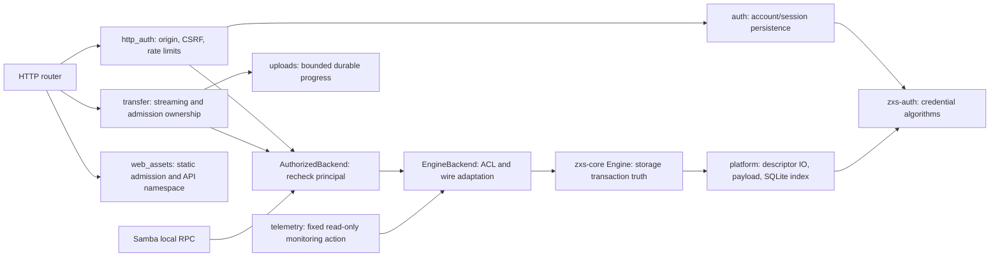

# Server / Platform / Shared Authentication review

## Scope and reading

Reviewed the server and platform production modules, their in-module regression tests, integration tests, manifests and module READMEs; initial source scope was about 16,002 Rust lines across server/platform. The audit followed actual call paths (HTTP admission -> account state -> authorized backend -> core; payload and index publication), not only lint output. New shared authentication sources were copied from the previously identical platform/server primitive implementation. No actual runtime/zxs-data/user pool was read or mutated and no service was started, stopped or restarted.

## Responsibility graph

## Fixed findings and evidence

1. **Duplicated credential algorithm source.** `server/auth_primitives.rs` and `platform/admin_auth/mod.rs` were both 1,263 lines and differed only in module documentation. Added independent portable `zxs-auth`; both old public paths re-export it. Removed unused direct cryptographic dependencies from both adapters. Root workspace membership/dependency and lockfile updated. Hash policy, token/CSRF domain constants, serialization and storage format are unchanged; the original 13 primitive tests now run once in zxs-auth.
2. **Upload cancellation released write ownership before blocking work stopped.** A cancelled HTTP future dropped its per-item claim and semaphore permit while `spawn_blocking` continued publication; a retry could enter concurrently. New shared `UploadAdmission` is retained by blocking progress-persistence tasks and by the publication/status completion closure. The final complete record is persisted within that same task. The regression blocks a backend publication, aborts the HTTP task, verifies a retry receives `FILE_WRITE_BUSY`, then releases it and verifies durable complete status.
3. **Queued account mutation bypassed recovery block.** `upsert_account` lacked `require_available`; after an uncertain auth backup, a previously admitted queued mutation could modify the in-memory account map. Added the availability check before any work; existing backup-failure test now verifies rejected mutation and identical snapshots.
4. **Range/HEAD inconsistencies.** Missing hyphen returned 400 while other invalid ranges returned 416; `u64::parse` admitted leading plus signs, duplicate Range lacked size evidence, and direct HEAD error responses carried JSON content. All malformed/duplicate/unsatisfiable ranges now use 416 plus `Content-Range: bytes */size` and accept-ranges. HEAD body is empty, valid HEAD content length remains accurate. Tests cover u64 limits, suffix/open/clamped reads, stale If-Range, malformed/duplicate ranges, and download lease lifetime for full consumption and cancellation.
5. **Unbounded/incorrect upload progress read.** `fs::read` allocated all bytes before checking the 16 KiB cap, and invalid JSON was misreported as a client 400. Bounded read now reads at most limit+1, malformed/oversized records produce `UPLOAD_STATE_INVALID` 500, and empty staging names are rejected. `usize` prefix length conversion is checked rather than truncating.
6. **Failed progress publication leaked temporary metadata.** The atomic progress writer now removes its own temporary file on write/sync/rename failure; regression occupies the destination with a directory to prove deterministic cleanup without permission assumptions.
7. **Account rate-limit identity drift and duplicate policy.** Login lowercased username keys but credential normalization also accepts outer ASCII spaces, allowing the same account to use multiple username buckets across IPs. Login now uses the credential canonicalizer; login/password change share one 60-second/10-attempt/4096-key admission helper. Key capacity is enforced before each insertion, counters saturate, expiration is shared. Tests verify aliases share budget across IPs and capacity never exceeds the cap. Cookie Max-Age references the account session TTL constant.
8. **History repeatedly scanned all commits per version while holding engine mutex.** `file_history` now builds first-commit and branch-head indices once, preserving minimum sequence, stable first branch id, real ancestor filtering, timestamps and wire order. Existing real Engine HTTP history test checks durable edges, independent branches, permissions and persistence. This is a complexity improvement inferred from code, not a measured throughput claim.
9. **SMB listing ignored PortableNameV2 matching.** `Request::List` compared raw display path prefixes, so casefold/Unicode aliases accepted by open/find returned empty directory listings. Listing now validates the directory and filters normalized lookup keys at component boundaries. Real Engine regression creates Straße/STRASSE nested entries, checks aliases, direct-child-only listing, NOT_DIRECTORY and missing-directory errors.
10. **Static fallback could shadow API and violate JSON error envelope.** With web_dir configured, all unknown paths fell through ServeDir: missing API returned non-JSON 404, and an accidental same-name asset under v1 could become HTTP 200 or static conditional 304. Added reserved /v1 boundary and excluded API paths from static validators; missing API/static paths return the consistent NOT_FOUND JSON envelope. Regression creates an actual web/v1/unknown file and sends If-None-Match:* to prove no content/304 bypass; index HTML still serves normally.

## Structure and documentation

- Extracted HTTP auth admission/endpoints to `server/http_auth.rs`, byte transport to `server/transfer.rs`, static admission/validators to `server/web_assets.rs`. `lib.rs` concentrates routing/configuration/shared state and backend wiring; tests retain public boundary coverage.
- Authentication implementation is in zxs-auth/src/lib.rs, original tests in tests.rs, with compatibility exports at existing paths.
- Rewrote the previously compressed file-history mapping into explicit passes and named intermediate values.
- Updated server/platform READMEs with module ownership, shared auth dependency, cancellation semantics, Range/HEAD and API namespace rules. Removed a stale fixed integration-test count from server README.

## Verification

- `cargo check --offline -p zxs-auth -p zxs-server -p zxs-platform`: passed after shared crate extraction.
- Earlier complete run passed 13 auth + 53 platform + 46 server + 12 real Engine HTTP + 1 telemetry integration = 125 tests, before the final rate/list/static additions.
- After rate additions, server lib 48 tests passed; SMB normalized-list regression separately passed.
- Final sandbox full run: auth passed; platform 50 passed / 3 failed because the sandbox rejected existing FIFO creation and ownership fixture syscalls (EPERM/EINVAL), not because assertions about changed code failed. The identical command was rerun with the required host syscall access and passed all tests; raw log the historical temporary test directory/log.
- Final command: `cargo test --locked --offline -p zxs-auth -p zxs-platform -p zxs-server`.
- **Final host full run passed: 13 auth + 53 platform + 50 server + 12 real Engine HTTP + 1 telemetry = 129 tests, zero failed/ignored and no warnings.** The latest static namespace, canonicalized List and account rate-limit tests all ran in this result.
- `cargo check --locked --offline -p zxs-server --no-default-features`: passed, no warnings. The existing core-only disk sensor exports/helpers are now correctly cfg-gated rather than producing dead-code/unused-import warnings in that build.
- `cargo fmt -p zxs-auth -p zxs-server -p zxs-platform --check`: passed.
- `cargo test --locked --offline -p zxs-server --no-default-features --lib`: passed 39 tests, zero failed/ignored and no warnings; raw log the historical temporary test directory/log.
- Raw native regression output is retained for the root's consolidated evidence; it contains fixture/test names only, no real credentials or runtime state.

## Limits of evidence

- No live server/browser acceptance or production deployment performed by this agent. HTTP tests use in-process routers and disposable real Engine pools; telemetry integration reads actual host counters and registered temporary disks.
- No physical device removal/power-loss matrix or six-platform binary package build was performed. Platform remains Linux-only; shared auth has no Linux/SQLite/framework dependency.
- No performance benchmark was run. The main EngineBackend action dispatcher and SMB session implementation remain explicit because splitting transaction operations without evidence would add risk; this audit preserves storage authority in core.
- Failed/interrupted work data retention and existing offline administration policy remain in place; this change introduces no garbage collection or storage-format migration.

## File coverage inventory

- `crates/zxs-auth/Cargo.toml` (17 lines)
- `crates/zxs-auth/README.md` (7 lines)
- `crates/zxs-auth/src/lib.rs` (678 lines)
- `crates/zxs-auth/src/tests.rs` (586 lines)
- `crates/zxs-platform/Cargo.toml` (31 lines)
- `crates/zxs-platform/README.md` (28 lines)
- `crates/zxs-platform/src/admin_auth/mod.rs` (5 lines)
- `crates/zxs-platform/src/error/fixtures/error-envelope.json` (71 lines)
- `crates/zxs-platform/src/error/mod.rs` (415 lines)
- `crates/zxs-platform/src/fs_safety/linux.rs` (217 lines)
- `crates/zxs-platform/src/fs_safety/mod.rs` (657 lines)
- `crates/zxs-platform/src/fs_safety/unix.rs` (838 lines)
- `crates/zxs-platform/src/lib.rs` (19 lines)
- `crates/zxs-platform/src/payload.rs` (286 lines)
- `crates/zxs-platform/src/schema_identity/fixtures/schema-fingerprint-v1.json` (28 lines)
- `crates/zxs-platform/src/schema_identity/mod.rs` (677 lines)
- `crates/zxs-platform/src/secret/mod.rs` (97 lines)
- `crates/zxs-platform/src/sqlite/blocking.rs` (125 lines)
- `crates/zxs-platform/src/sqlite/mod.rs` (568 lines)
- `crates/zxs-platform/src/sqlite/native_limits.rs` (230 lines)
- `crates/zxs-platform/src/sqlite/native_security.rs` (110 lines)
- `crates/zxs-platform/src/sqlite/tests.rs` (429 lines)
- `crates/zxs-platform/src/sqlite/trusted_ddl.rs` (191 lines)
- `crates/zxs-platform/src/sqlite/validation_snapshot.rs` (782 lines)
- `crates/zxs-server/Cargo.toml` (36 lines)
- `crates/zxs-server/README.md` (112 lines)
- `crates/zxs-server/src/auth.rs` (641 lines)
- `crates/zxs-server/src/auth_primitives.rs` (5 lines)
- `crates/zxs-server/src/engine_backend/file_manager.rs` (798 lines)
- `crates/zxs-server/src/engine_backend.rs` (1344 lines)
- `crates/zxs-server/src/file_manager.rs` (73 lines)
- `crates/zxs-server/src/http_auth.rs` (426 lines)
- `crates/zxs-server/src/lib.rs` (1101 lines)
- `crates/zxs-server/src/smb_rpc.rs` (1474 lines)
- `crates/zxs-server/src/telemetry/README.md` (51 lines)
- `crates/zxs-server/src/telemetry/history.rs` (737 lines)
- `crates/zxs-server/src/telemetry/mod.rs` (395 lines)
- `crates/zxs-server/src/telemetry/power.rs` (328 lines)
- `crates/zxs-server/src/telemetry/statistics.rs` (120 lines)
- `crates/zxs-server/src/transfer.rs` (712 lines)
- `crates/zxs-server/src/uploads.rs` (266 lines)
- `crates/zxs-server/src/web_assets.rs` (129 lines)
- `crates/zxs-server/tests/http_engine.rs` (1734 lines)
- `crates/zxs-server/tests/telemetry_status.rs` (225 lines)

### Follow-up: direct credential dependency

The server `auth_primitives` and platform `admin_auth` compatibility re-exports have since been removed. Server and CLI callers now depend directly on `zxs-auth`; credential algorithms and persisted formats are unchanged. The earlier module inventory above records the review at that time, not the current file layout.
