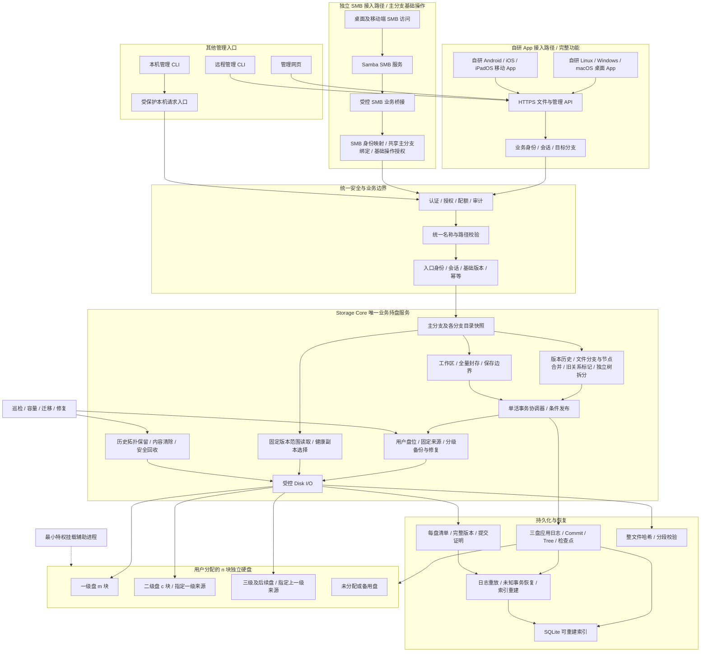

# 03 总体架构与模块边界

[文档目录](README.md) · [上一章：术语、对象与核心不变量](02-concepts-and-invariants.md) · [下一章：六平台客户端与访问入口](04-platforms-and-access.md)

一张完整总架构图，以及 App、SMB、核心和持盘边界。

## 本章目录

- [3.1 完整总体架构图](#s03-01)
- [3.2 接入与持盘边界](#s03-02)
- [3.3 技术基线](#s03-03)

## 3.1 完整总体架构图

App 经业务 API 接入，SMB 经 Samba 和服务端桥接接入；两条路径分别建立连接，在服务端共用权限校验、存储核心、持久化和分层备份。SMB 的主分支与基础操作限制由服务端执行，App 的分支选择不改变 SMB 目标。

## 3.2 接入与持盘边界

采用 Samba 承担 SMB 协议服务，通过受控业务桥接将基础文件操作送入 Storage Core。桥接采用 Samba VFS 扩展和受保护本机接口；目标 SDK 与已验证路径见[SMB 桥接说明](../integrations/smb/README.md)。其他版本及完整应用操作矩阵仍需单独验证。这里需要实现业务对接，但不重写 SMB 协议、不开发客户端虚拟盘，客户端无需本系统自研挂载。[S03][S04]

SMB 共享绑定 `(repository_id, history_tree_id, main_branch_id, share_generation)`，只展示该主分支当前文件。分支、历史图、清除、拆分、备份和磁盘管理通过 App、Web 或 CLI 访问；不得借可写隐藏目录或特殊文件名触发。

SMB 服务及 API 网关不直接共享版本对象目录。Storage Daemon 仍是业务持盘和授权的最终边界；桥接只能提交受限请求，不能绕过命名、保护份数或历史保存。Samba 本身不能替本系统提供版本事务或跨盘保护保证。

桌面 App 和移动 App 均由本项目自行实现，共用业务连接、认证、文件操作、缓存及任务状态组件，所有 App 功能通过业务 API 完成。SMB 入口由 Samba 和服务端业务桥接独立提供，App 不包含 SMB 访问模块。网页使用相同业务契约，管理 CLI 可走本机受保护接口或远程 HTTPS。服务器本机也可以分别使用 Linux App 或独立 SMB 入口。管理员内部维护接口不能成为普通应用绕过业务规则的入口。

“三盘元数据”表示用户指定的三个不同物理数据盘兼任控制日志成员，并非另外增加三块硬盘。数据盘仍各自独立，不组成跨盘条带。

## 3.3 技术基线

| 领域 | 基线 | 说明 |
| --- | --- | --- |
| 服务端 | Rust Storage Daemon | 一个有效写协调器；可并行准备数据，按事务顺序发布 |
| 独立 SMB 接入 | Samba / SMB 3 系列 | 共享主分支基础文件，独立于 App 接入，服务端统一执行业务规则；不启用 SMB1 |
| SMB 业务桥接 | Samba VFS 扩展到受控核心接口 | 同步执行核心业务操作；完整操作路径按目标 SDK 验证 |
| 本机内部通信 | Unix Domain Socket | 受信服务身份和受限用户代理，不接受任意身份自报 |
| App / Web / 远程 CLI | HTTPS，优先 HTTP/2 | HTTP/3 为可选扩展，不改变保存语义 |
| 各端 App | 本项目自行实现的 App 和共享客户端核心 | 自行实现连接、认证、界面、文件操作、缓存、任务及错误展示，通过业务 API 访问 |
| 桌面 App | 自研 Linux、Windows、macOS 独立安装客户端 | 文件与高级管理功能均经统一业务 API 访问 |
| 移动 App | 自研 Android、iOS、iPadOS 客户端 | 提供相同业务功能，通过业务 API 访问，界面及后台任务按系统适配 |
| 每盘文件系统 | 独立 Btrfs | 保持数据校验；恢复环境兼容性独立验收 |
| 内容格式 | 仅 FULL 普通文件 | 每个新写内容版本独立完整；分支创建引用冻结父版本，首次写入才生成自有 FULL |
| 元数据 | 三成员应用日志与检查点 | 两成员决定、三成员保护后正常发布 |
| 索引 | SQLite，可重建 | 不将 SQLite WAL 当成跨盘事务 |
| 校验 | BLAKE3 整文件与分段清单 | 范围验证和全文件验证分别执行 |
| 命名 | PortableNameV2 / PortablePathV1 | 固定 Unicode 数据版本，各入口统一校验 |
| 恢复 | 独立只读离线工具 | 不依赖在线索引或其他历史版本打开本盘文件 |

[S03]: https://www.samba.org/samba/docs/current/man-html/smbd.8.html
[S04]: https://www.samba.org/samba/docs/current/man-html/smb.conf.5.html

---

[文档目录](README.md) · [上一章：术语、对象与核心不变量](02-concepts-and-invariants.md) · [下一章：六平台客户端与访问入口](04-platforms-and-access.md)
