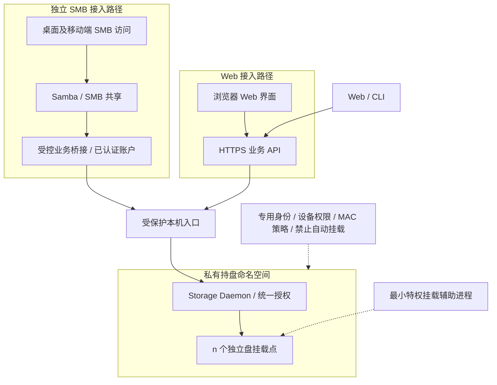

# 14 身份、权限与运行隔离

[文档目录](README.md) · [上一章：历史内容清除与安全回收](13-retention-and-deletion.md) · [下一章：API、操作结果与错误契约](15-api-and-errors.md)

入口认证、授权范围、本机隔离和恢复访问边界。

## 本章目录

- [14.1 部署隔离图](#s14-01)
- [14.2 唯一正常数据入口](#s14-02)
- [14.3 不能只设置一个隐藏目录](#s14-03)
- [14.4 最小特权](#s14-04)
- [14.5 本地身份不能伪造](#s14-05)
- [14.6 授权对象](#s14-06)
- [14.7 根用户与离线访问的边界](#s14-07)
- [14.8 Web 与网络安全](#s14-08)
- [14.9 故障关闭](#s14-09)
- [14.10 权限与操作范围](#s14-10)

## 14.1 部署隔离图

Web 与 SMB 分别接入服务端，统一核心负责授权及持盘业务。SMB 桥接仅代理获授权的主分支基础操作，不获得物理目录的直接业务访问权。

## 14.2 唯一正常数据入口

普通应用通过 SMB 访问当前主分支，Web 和内部管理 CLI 调用同一核心规则。底层盘目录和版本对象不直接共享，不发布访问内部目录的静态网页路径。

Storage Daemon 的 Disk I/O 是实际持盘组件，恢复、巡检和迁移通过内部受控任务执行。SMB 桥接不能在失败后回退到物理目录直读直写；不得共享可绕过历史和授权的旁路。

## 14.3 不能只设置一个隐藏目录

需要组合专用服务用户、私有 mount namespace、私有传播、挂载点访问权限、块设备访问控制、systemd 沙箱以及合适的 AppArmor/SELinux 策略。

systemd 的 `PrivateMounts=` 影响挂载命名空间和传播，但不能替代身份、设备权限和路径限制，也不能把原先已公开的设备自动变成安全资源。[S19]

数据盘应由受控挂载流程接管，禁用相关自动挂载。主机普通命名空间不应先把所有盘暴露给用户后，再认为服务端创建一个私有视图就完成隔离。

## 14.4 最小特权

挂载辅助进程只处理白名单设备、登记的 UUID、固定选项及指定命名空间，不接受用户任意路径或任意 mount 参数。完成挂载后不把长期不必要的特权交给业务服务。

业务进程不向客户端传递底层目录句柄或可写物理文件描述符。本机管理通信可优化传输，但不能绕过命名、历史、授权、一级归属和固定备份目标。

已发布对象使用只读业务权限。文件属主或完整管理员仍可能改变权限，因此它是防意外措施，不是不可突破的防篡改硬件。

## 14.5 本地身份不能伪造

核心收到 Unix Socket 连接时，对端可能是 Samba 桥接进程，而非最终用户。仅信任经过验证的服务身份及受限代理通道，将 Samba 已认证安全身份映射为核心账户，每个请求继续校验其授权范围。

不能允许任意本机程序填 UID、SID、用户名或 branch_id 就获得他人权限。SMB 客户端自报路径和远程 UID 均不作为授权依据；Web 和内部管理 CLI 也通过各自已认证会话映射账户。

## 14.6 授权对象

权限至少覆盖每个历史域的读取、历史读取、分支创建/写入、旧关系标记端点查看、文件分支合并与节点标签写入、内容清除、独立树拆分、恢复、保护策略、备份拓扑与盘位绑定变更、归档、磁盘维护和管理员操作。

知道 `version_id`、history_tree_id、内容对象 ID、下载链接或另一个分支名称不等于有权读取。历史内容接口必须校验本域历史权限、内容状态和可达范围；PURGED及迁出源对象不能因物理文件仍存在而重新授权。

权限撤销是当前安全状态，不能因从历史创建分支或拆分来源映射自动恢复已撤销的账户权限。历史 ACL 可以保存供审计，但是否恢复必须是独立、受权限控制的操作。

## 14.7 根用户与离线访问的边界

拥有完整宿主机管理权、能够访问原始块设备或控制启动环境的人，通常仍能绕过应用目录权限。本架构主要防止普通程序和日常操作意外破坏，不声称能抵御完全控制宿主机的攻击者。

盘上若保存明文普通文件，拆盘就能读取本盘内容；这同时意味着物理持盘者可以绕过服务器 ACL。若以后引入加密，应另行定义恢复密钥和独立读取流程，不能既要求无密钥直接读取又宣称失窃盘不可读。

## 14.8 Web 与网络安全

Web 和内部远程 CLI 使用经过验证的 TLS 连接，不提供忽略证书的默认开关。SMB 使用已验收的 SMB 3 安全配置，按部署要求启用签名和加密；远程 SMB 走受控网络通道，不以匿名共享或关闭保护解决兼容问题。认证令牌限制作用域、有效期和设备会话，敏感管理操作再次验证权限。

浏览器使用会话 Cookie 时实施 CSRF 防护；CORS 使用明确来源白名单。用户上传的 HTML、SVG 等主动内容不得在管理界面的可信同源上下文直接执行，预览需隔离或按安全类型提供。

路径使用 ID 和 JSON 名称字段传输，避免多重 URL 解码造成路径逃逸。请求日志不记录令牌、完整敏感文件内容或未经处理的控制字符。

对会产生副作用的请求禁止早期重放执行；幂等键与请求摘要由核心持久化，不能只在网关内存去重。

## 14.9 故障关闭

SMB 服务、业务桥接或核心未就绪时，共享返回不可用；不能退化为普通本地空目录，也不能将物理盘卸载后留下的目录当作正常写入目标。

核心写入前验证设备身份和目录句柄，不仅检查路径存在。客户端挂载共享的本地目录在断开后是否可被写入取决于客户端环境，应在支持说明和自动化任务中要求连接健康检查，不能把客户端本地写入视为已保存到服务器。

服务故障不能通过返回空目录表示全部文件已删除；同步或备份任务必须区分不可用、无权限和真实空目录，防止据此批量删除另一端文件。

## 14.10 权限与操作范围

当前仓库授权使用共享契约 `RepositoryAccess` 与 `Grants::allows`：`Read` 和 `Write` 独立授予，`Manage` 同时满足读取与写入要求。仅有写入权限不自动获得读取权限，也不得因服务端预检查额外要求读取而阻断允许的写入。服务端和核心复用同一仓库权限判断；账户准入、会话有效性和管理员身份仍在服务端身份边界检查，核心继续检查业务目标及存储授权。操作幂等重放沿用原主体与摘要约束，不借重放提升权限。

| 操作 | 必须核对的权限和状态 |
| --- | --- |
| 当前文件读取或保存 | 当前账户、目标目录与文件、入口能力、分支状态；SMB 还须核对共享主分支绑定 |
| 历史元数据查看 | 历史树与节点的查看权限，不因知道 ID 或名称而放行 |
| 历史内容读取或导出 | 历史内容权限、当前内容状态及读取租约，不能使用已清除版本 |
| 分支创建 | 来源状态的必需读取权限、目标分支创建权限及有效保护规则 |
| 合并连线 | 两端节点的历史查看权限及关系标记权限；不附带文件修改权限，也不要求已清除内容可读 |
| 文件分支合并 | 文件写入权限、参与分支可写且head基线未变、结果正文可验证；只读别名不可作为写入目标，详见[合并规则](design/file-merge-tags-backup.md) |
| 当前文件删除 | 当前目录项的删除权限，不等同于清除历史内容权限 |
| 历史内容清除 | 清除权限、全部受影响视图的授权范围及内容保留引用 |
| 历史树拆分 | 历史域管理权限、新树授权范围及受影响分支、共享绑定 |
| 备份与设备维护 | 策略、拓扑、盘位、成员配置及对应管理员权限 |

故障后继续提供正常在线读取，必须能验证已发布状态、当前授权和内容清除记录。无法确认权限或墓碑是否为当前状态时，不得按旧快照放行业务读取；仅允许获授权管理员进行隔离的只读核验与恢复导出。单盘恢复能力不等同于正常在线服务的授权能力。

[S19]: https://www.freedesktop.org/software/systemd/man/latest/systemd.exec.html

---

[文档目录](README.md) · [上一章：历史内容清除与安全回收](13-retention-and-deletion.md) · [下一章：API、操作结果与错误契约](15-api-and-errors.md)
