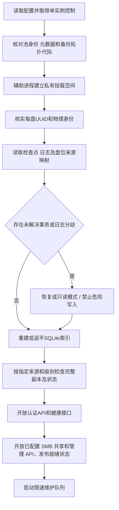

# 17 初始化、启停与硬盘维护

[总目录](../README.md) · [上一章：App、网页与命令行界面](16-client-interfaces.md) · [下一章：故障处理与降级行为](18-failure-handling.md)

设备登记、就绪状态、安全拔盘、换盘和成员恢复。

## 本章目录

- [17.1 初始化与正常启动分开](#s17-01)
- [17.2 启动顺序](#s17-02)
- [17.3 关机顺序](#s17-03)
- [17.4 主动拔盘前检查](#s17-04)
- [17.5 排空与换盘](#s17-05)
- [17.6 元数据成员更换与中断恢复](#s17-06)
- [17.7 运维和审计](#s17-07)

## 17.1 初始化与正常启动分开

首次初始化必须显式执行，确认选择的设备、已有数据情况、身份信息和元数据组。普通启动绝不自动格式化盘、生成新存储池或覆盖已有身份。

本文不提供针对 `/dev/sda` 一类易变设备名的直接格式化命令。部署工具必须先展示稳定设备身份和操作后果。

## 17.2 启动顺序

图中恢复模式进入索引追平，不代表恢复完成前允许写入。是否开放可写接口必须由独立的就绪状态控制。

## 17.3 关机顺序

先阻止新工作区和新写租约，处理或明确保留已有写入，完成已决定事务或记录恢复状态，持久化必要日志与检查点，再关闭 SMB 接入和管理入口，安全卸载物理盘并停止服务。

不能强制先卸载数据盘、再等待核心把待提交文件刷进去。达到关机超时仍有未知事务时，应保留恢复标记，不伪造干净关机。

## 17.4 主动拔盘前检查

对于指定盘，计算它承载的当前及历史完整文件、工作区、清除残留、元数据成员身份和最后健康完整副本，以及分支创建和拆分任务。

“拔盘后仍保持在线访问与目标保护”模式下，先由用户为该盘位指定替换物理盘，或审查新的来源拓扑并完成迁移；不能把副本临时分散到任意空盘。单份版本仅在该一级盘时，须在相同角色的替换盘或用户明确指定的新一级盘完成验证后才能满足该模式。

用户也可以明确选择“保留盘上数据并离线带走”，但系统要展示哪些版本将暂时不可访问、哪些保护等级不足，以及是否导致元数据组三成员条件不满足。

安全卸载只保证停止本系统写入和完成已声明的同步，不等于拔盘后全仓继续完整在线。

## 17.5 排空与换盘

盘状态至少区分 `ONLINE`、`DRAINING`、`OFFLINE`、`SUSPECT`、`QUARANTINED`、`REMOVED`。排空盘不接受新放置，已有读取是否继续由健康策略决定。

换盘计划绑定明确slot_id、copy_level、来源列表及新物理身份，复制和验证全部该角色数据后才更新binding_generation与旧盘状态。该角色兼任元数据成员时，必须同时按[第 17.6 节](17-lifecycle-and-maintenance.md#s17-06)完成成员更换/隔离；不能以业务盘替换绕过控制日志保护。克隆出来的重复 disk_id 必须被识别并停止接纳，不按盘符顺序擅自改认。

## 17.6 元数据成员更换与中断恢复

正常更换和故障恢复都暂停业务写入，采用一次只替换一个成员的保守流程。不能通过修改配置文件跳过记录，也不能因另有健康内容盘就把它视为已有元数据成员。

1. 停止并隔离旧写者，取得独占持盘权限。核实最近有效成员配置及任何未完成的恢复计划，至少取得两个当前旧成员的完整证据。
2. 根据[第 10.7 节](10-transactions-and-recovery.md#s10-07)计算唯一恢复结果，创建 `recovery_id` 和只增不减的新 membership_epoch。计划固定旧新成员集合、可信前缀、各未决槽位结果及候选哈希。
3. 向两个旧成员持久化同一 `RECOVERY_FENCE`，收到两份同步回执后才允许执行计划。该记录禁止旧配置继续接纳业务写入；只写一份时不能激活新配置。
4. 需要补交的旧候选以原 commit_id 和内容身份在两个旧成员形成决定；无候选槽位的中止结果也写两份 `RECOVERY_RESOLVE`。这些是受计划约束的恢复写入，不开放新业务事务。
5. 把已解决前缀、决定证明、权限、策略、操作结果及成员计划完整复制到新组三个成员；内容另行校验，缺失内容记录明确健康状态。
6. 生成包含旧组两份 FENCE/RESOLVE 回执的新配置激活记录，向新组三个成员写入 `CONFIG_ACTIVATE` 并同步。再生成引用三份激活回执的激活完成证明并写三份；完成前不开放正常写入。
7. 在新组三个成员持久化新的 writer_epoch。对需恢复完成的候选，由新组三盘分别同步依赖并记录 REPROTECT，生成当前代际 FINALIZE，再按[第 10.10 节](10-transactions-and-recovery.md#s10-10)恢复 PUBLICATION、两类本盘证明、操作结果和索引。已有有效发布记录保持原保护事实；缺少正常发布证据且不能补齐内容时，按唯一恢复计划记录降级结果。普通新提交仍须三成员和逐版本保护达标。
8. 旧盘重新插回只能核查或隔离。成员身份和代际来自可信配置链，不按盘符、mtime 或“最高自报 epoch”决定接纳。

恢复计划本身只有两份旧成员 FENCE 持久化后才能获得执行资格。若中断后仅见一份计划，而另外两个旧成员的完整记录均无计划，允许在隔离旧写者后废弃这个未获资格的计划。若所取两个旧成员中任一个记录了计划，则保守地继续该相同计划并补齐证据，不创建不同目标组。发现两个不同有效计划立即停止调查。

新配置激活中断时，只能重试同一 recovery_id、成员集合和代际，不能从旧配置重新开展业务写入。存在有效激活完成证明时按新配置恢复；只有部分激活记录时继续同一计划，要求能重建旧组两份授权证据和新组三份完整状态。所需成员暂时不可用时保持停止，不隐式退回旧组。

少于两个可信旧成员且没有足以验证已完成配置切换的证明时，不承诺恢复原池写服务。允许从剩余盘只读核对和导出，再由管理员显式建立不同 pool_id 的新池并导入；必须展示无法确认的事务及缺失版本，不能称为原池无损接管。

## 17.7 运维和审计

维护任务包括磁盘健康、Btrfs与逻辑巡检、来源和级别完整副本验证、指定盘位修复、清除残留、拆分恢复、用户确认的拓扑迁移、容量建议、检查点及GC。后台任务不能自行做跨来源负载均衡。

每项任务要有 ID、作用范围、进度、可取消阶段和最终结果。后台任务可以限速或暂停，但不能因暂停而让已持久化的提交回退成未提交。

需要可观测的指标包括每级盘位/来源占用、备份链完整度和拓扑迁移进度、每盘可用空间、SMB 会话和失败保存、全量分支和拆分过渡占用、合并连线记录状态、PURGED节点与离线清除残留、版本保护不足数、不可读版本数、日志成员健康、事务状态分布、未提交工作区空间、校验错误、缓存命中和读写延迟。告警不能只看 CPU 或内存正常就判定存储正常。

---

[总目录](../README.md) · [上一章：App、网页与命令行界面](16-client-interfaces.md) · [下一章：故障处理与降级行为](18-failure-handling.md)
