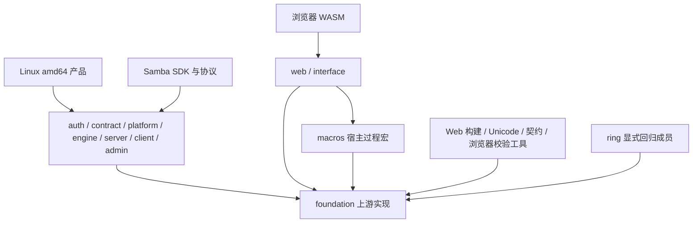

# Foundation 消费者与功能架构索引

由 `python3 tools/rust-sources/architecture.py refresh` 生成；`verify` 拒绝过期内容。

来源：当前全部 Cargo manifest、`workspaces.json` 和经 metadata 验证的 `compliance/rust-sources.json`。下列直接消费者包含 normal/build/dev、可选及目标条件声明；它们不等同于实际启用的边。功能列表来自整个工作区统一特性后的保守闭包，直接 dev 边虽不遍历，dev 激活的功能仍可能扩大闭包。runtime/compile 是维护角色，不证明最终链接或单消费者实际编译输入。

物理目录按职责维护独立 crate 边界，当前名称与原始身份通过来源清单关联；跨网络、加密、Web 的共享库不按业务领域硬搬目录。项目需要的微型实现合并到真实消费者，来源身份继续登记。原生验收仅 `x86_64-unknown-linux-gnu`；浏览器为 `wasm32-unknown-unknown`。

## 登记入口与保守功能闭包

| 入口 | Cargo 根包目录 | 目标 | 来源数 / runtime / compile |
| --- | --- | --- | --- |
| root-native | src/auth/Cargo.toml, src/contract/Cargo.toml, src/naming/Cargo.toml, src/platform/Cargo.toml, src/engine/Cargo.toml, src/server/Cargo.toml, src/client/Cargo.toml, src/admin/Cargo.toml | x86_64-unknown-linux-gnu | 169 / 147 / 23 |
| web | src/web/Cargo.toml | wasm32-unknown-unknown | 92 / 55 / 42 |
| smb | src/smb/Cargo.toml, src/smb-vfs/Cargo.toml | x86_64-unknown-linux-gnu | 38 / 15 / 30 |
| build-tools | tools/web-build/Cargo.toml, tools/release-tools/Cargo.toml, tools/web-bindings/Cargo.toml | x86_64-unknown-linux-gnu | 67 / 0 / 67 |
| validation-tools | tools/contract-check/Cargo.toml, tools/browser-smoke/Cargo.toml, tools/unicode-build/Cargo.toml, tools/perf-check/Cargo.toml | x86_64-unknown-linux-gnu | 141 / 0 / 141 |

角色可重叠，计数不可相加。显式验证成员：src/foundation/ring。

## 每个保留来源的直接消费者、角色与功能

| 当前来源目录 / 身份 | 全部声明的直接消费者 | 保守入口角色与统一 features |
| --- | --- | --- |
| src/foundation/adler2 (adler2@2.0.1) | src/foundation/miniz_oxide [normal] | build-tools@x86_64-unknown-linux-gnu: compile; features=(none) |
| src/foundation/ahash (ahash@0.8.12) | src/foundation/jsonschema [normal]; src/foundation/jsonschema-value [normal]; src/foundation/referencing [normal] | validation-tools@x86_64-unknown-linux-gnu: compile; features=default,getrandom,runtime-rng,serialization,std |
| src/foundation/allocator-api2 (allocator-api2@0.2.21) | src/foundation/bumpalo [normal, optional]; src/foundation/hash-table [normal, optional] | root-native@x86_64-unknown-linux-gnu: runtime; features=alloc; web@wasm32-unknown-unknown: runtime; features=alloc; build-tools@x86_64-unknown-linux-gnu: compile; features=alloc; validation-tools@x86_64-unknown-linux-gnu: compile; features=alloc |
| src/foundation/anstream (anstream@1.0.0) | src/foundation/command-line [normal, optional]; src/foundation/env_logger [normal, optional] | root-native@x86_64-unknown-linux-gnu: runtime; features=auto,default; build-tools@x86_64-unknown-linux-gnu: compile; features=auto,default |
| src/foundation/anstyle (anstyle@1.0.14) | src/foundation/anstream [normal]; src/foundation/command-line [normal]; src/foundation/env_logger [normal, optional] | root-native@x86_64-unknown-linux-gnu: runtime; features=default,std; build-tools@x86_64-unknown-linux-gnu: compile; features=default,std |
| src/foundation/anstyle-parse (anstyle-parse@1.0.0) | src/foundation/anstream [normal] | root-native@x86_64-unknown-linux-gnu: runtime; features=default,utf8; build-tools@x86_64-unknown-linux-gnu: compile; features=default,utf8 |
| src/foundation/anstyle-query (anstyle-query@1.1.5) | src/foundation/anstream [normal, optional] | root-native@x86_64-unknown-linux-gnu: runtime; features=(none); build-tools@x86_64-unknown-linux-gnu: compile; features=(none) |
| src/foundation/anyhow (anyhow@1.0.104) | src/foundation/walrus [normal]; src/foundation/wasm-bindgen-cli-support [normal]; tools/web-bindings [normal]; tools/web-build [normal] | build-tools@x86_64-unknown-linux-gnu: compile; features=default,std |
| src/foundation/argon2 (argon2@0.5.3) | src/auth [normal] | root-native@x86_64-unknown-linux-gnu: runtime; features=alloc,default,password-hash,rand,std |
| src/foundation/arrayvec (arrayvec@0.7.8) | src/foundation/anstyle-parse [normal, optional]; src/foundation/blake3 [normal] | root-native@x86_64-unknown-linux-gnu: runtime; features=(none); web@wasm32-unknown-unknown: runtime; features=(none); smb@x86_64-unknown-linux-gnu: runtime; features=(none); validation-tools@x86_64-unknown-linux-gnu: compile; features=(none) |
| src/foundation/async-lock (async-lock@3.4.2) | src/foundation/reactive-state [normal] | web@wasm32-unknown-unknown: runtime; features=default,std |
| src/foundation/async-trait (async-trait@0.1.92) | src/foundation/jsonschema [normal, optional]; src/foundation/referencing [normal, optional]; src/foundation/view-renderer [normal] | web@wasm32-unknown-unknown: compile; features=(none) |
| src/foundation/atoi (atoi@2.0.0) | src/foundation/sqlite-access [normal] | root-native@x86_64-unknown-linux-gnu: runtime; features=default,std; validation-tools@x86_64-unknown-linux-gnu: compile; features=default,std |
| src/foundation/atomic-waker (atomic-waker@1.1.2) | src/foundation/http-transport [normal, optional] | root-native@x86_64-unknown-linux-gnu: runtime; features=(none) |
| src/foundation/attribute-derive (attribute-derive@0.11.0) | src/macros [normal] | web@wasm32-unknown-unknown: compile; features=syntax-full |
| src/foundation/attribute-derive-macro (attribute-derive-macro@0.11.0) | src/foundation/attribute-derive [normal] | web@wasm32-unknown-unknown: compile; features=(none) |
| src/foundation/autocfg (autocfg@1.5.1) | src/foundation/numeric [build] | root-native@x86_64-unknown-linux-gnu: compile; features=(none); validation-tools@x86_64-unknown-linux-gnu: compile; features=(none) |
| src/foundation/axum-macros (axum-macros@0.5.1) | src/foundation/http-routing [normal, optional] | root-native@x86_64-unknown-linux-gnu: compile; features=default |
| src/foundation/base64 (base64@0.23.1) | src/auth [normal]; src/foundation/http-transport [normal, optional]; src/foundation/reqwest [normal]; src/foundation/tower-http [normal, optional]; tools/browser-smoke [normal] | root-native@x86_64-unknown-linux-gnu: runtime; features=alloc,default,simd-unsafe,std; validation-tools@x86_64-unknown-linux-gnu: compile; features=alloc,default,simd-unsafe,std |
| src/foundation/base64ct (base64ct@1.8.3) | src/foundation/argon2 [normal]; src/foundation/password-hash [normal] | root-native@x86_64-unknown-linux-gnu: runtime; features=alloc,std |
| src/foundation/bindgen (bindgen@0.72.1) | src/foundation/libsqlite3-sys [build, optional]; src/smb-vfs [build, optional] | smb@x86_64-unknown-linux-gnu: compile; features=default,logging,runtime,rust-source-format |
| src/foundation/bit-set (bit-set@0.8.0) | src/foundation/fancy-regex [normal] | validation-tools@x86_64-unknown-linux-gnu: compile; features=std |
| src/foundation/bit-vec (bit-vec@0.8.0) | src/foundation/bit-set [normal]; src/foundation/sqlite-access [normal, optional] | validation-tools@x86_64-unknown-linux-gnu: compile; features=std |
| src/foundation/blake2 (blake2@0.10.6) | src/foundation/argon2 [normal] | root-native@x86_64-unknown-linux-gnu: runtime; features=(none) |
| src/foundation/blake3 (blake3@1.8.7) | src/client [normal]; src/contract [normal]; src/engine [normal]; src/platform [normal]; src/server [normal]; src/smb-vfs [normal]; src/web [normal]; tools/contract-check [normal] | root-native@x86_64-unknown-linux-gnu: runtime; features=default,std; web@wasm32-unknown-unknown: runtime; features=default,std; smb@x86_64-unknown-linux-gnu: runtime; features=default,std; validation-tools@x86_64-unknown-linux-gnu: compile; features=default,std |
| src/foundation/borrow-or-share (borrow-or-share@0.2.4) | src/foundation/fluent-uri [normal] | validation-tools@x86_64-unknown-linux-gnu: compile; features=alloc |
| src/foundation/bumpalo (bumpalo@3.20.3) | src/foundation/wasm-bindgen-macro-support [normal] | web@wasm32-unknown-unknown: compile; features=default |
| src/foundation/bytecount (bytecount@0.6.9) | src/foundation/jsonschema [normal]; src/foundation/jsonschema-value [normal, optional] | validation-tools@x86_64-unknown-linux-gnu: compile; features=runtime-dispatch-simd |
| src/foundation/bytes (bytes@1.12.1) | src/foundation/fraction [normal, optional]; src/foundation/http [normal]; src/foundation/http-body [normal]; src/foundation/http-routing [normal]; src/foundation/http-transport [normal]; src/foundation/reqwest [normal]; src/foundation/sqlite-access [normal]; src/foundation/tokio [normal, optional]; src/foundation/tokio-util [normal]; src/foundation/tower-http [normal]; src/server [normal] | root-native@x86_64-unknown-linux-gnu: runtime; features=default,std; validation-tools@x86_64-unknown-linux-gnu: compile; features=default,std |
| src/foundation/cc (cc@1.8.0) | src/foundation/blake3 [build]; src/foundation/libsqlite3-sys [build, optional]; src/foundation/ring [build] | root-native@x86_64-unknown-linux-gnu: compile; features=(none); web@wasm32-unknown-unknown: compile; features=(none); smb@x86_64-unknown-linux-gnu: compile; features=(none); validation-tools@x86_64-unknown-linux-gnu: compile; features=(none) |
| src/foundation/cexpr (cexpr@0.6.0) | src/foundation/bindgen [normal] | smb@x86_64-unknown-linux-gnu: compile; features=(none) |
| src/foundation/cfg-if (cfg-if@1.0.5) | src/foundation/ahash [normal]; src/foundation/blake3 [normal]; src/foundation/console_error_panic_hook [normal]; src/foundation/crc32fast [normal]; src/foundation/getrandom-0.2.17 [normal]; src/foundation/getrandom-0.4.3 [normal]; src/foundation/js-sys [normal]; src/foundation/libloading [normal, cfg(unix)]; src/foundation/ring [normal]; src/foundation/sha2 [normal]; src/foundation/synchronization [normal, optional]; src/foundation/thread_local [normal]; src/foundation/wasm-bindgen [normal] | root-native@x86_64-unknown-linux-gnu: runtime; features=(none); web@wasm32-unknown-unknown: runtime; features=(none); smb@x86_64-unknown-linux-gnu: compile+runtime; features=(none); build-tools@x86_64-unknown-linux-gnu: compile; features=(none); validation-tools@x86_64-unknown-linux-gnu: compile; features=(none) |
| src/foundation/clang-sys (clang-sys@1.9.1) | src/foundation/bindgen [normal] | smb@x86_64-unknown-linux-gnu: compile; features=clang_10_0,clang_11_0,clang_3_5,clang_3_6,clang_3_7,clang_3_8,clang_3_9,clang_4_0,clang_5_0,clang_6_0,clang_7_0,clang_8_0,clang_9_0,libloading,runtime |
| src/foundation/cmov (cmov@0.5.4) | src/foundation/ctutils [normal] | root-native@x86_64-unknown-linux-gnu: runtime; features=(none); build-tools@x86_64-unknown-linux-gnu: compile; features=(none); validation-tools@x86_64-unknown-linux-gnu: compile; features=(none) |
| src/foundation/colorchoice (colorchoice@1.0.5) | src/foundation/anstream [normal] | root-native@x86_64-unknown-linux-gnu: runtime; features=(none); build-tools@x86_64-unknown-linux-gnu: compile; features=(none) |
| src/foundation/command-derive (command-derive@4.6.7) | src/foundation/command-line [normal, optional] | root-native@x86_64-unknown-linux-gnu: compile; features=default; build-tools@x86_64-unknown-linux-gnu: compile; features=default |
| src/foundation/command-line (command-line@4.6.7) | src/admin [normal]; src/foundation/bindgen [normal, optional]; tools/web-bindings [normal] | root-native@x86_64-unknown-linux-gnu: runtime; features=color,default,derive,env,error-context,help,std,suggestions,usage; build-tools@x86_64-unknown-linux-gnu: compile; features=color,default,derive,env,error-context,help,std,suggestions,usage |
| src/foundation/concurrent-collections (concurrent-collections@0.8.23) | src/foundation/rayon-core [normal]; src/foundation/sqlite-access [normal] | root-native@x86_64-unknown-linux-gnu: runtime; features=alloc,default,std; build-tools@x86_64-unknown-linux-gnu: compile; features=alloc,default,std; validation-tools@x86_64-unknown-linux-gnu: compile; features=alloc,default,std |
| src/foundation/console_error_panic_hook (console_error_panic_hook@0.1.7) | src/interface [normal] | web@wasm32-unknown-unknown: runtime; features=(none) |
| src/foundation/const-oid (const-oid@0.10.2) | src/foundation/cryptographic-core [normal, optional] | root-native@x86_64-unknown-linux-gnu: runtime; features=(none); build-tools@x86_64-unknown-linux-gnu: compile; features=(none); validation-tools@x86_64-unknown-linux-gnu: compile; features=(none) |
| src/foundation/const_str_slice_concat (const_str_slice_concat@0.1.0) | src/foundation/view-renderer [normal] | web@wasm32-unknown-unknown: runtime; features=(none) |
| src/foundation/constant_time_eq (constant_time_eq@0.4.2) | src/foundation/blake3 [normal] | root-native@x86_64-unknown-linux-gnu: runtime; features=std; web@wasm32-unknown-unknown: runtime; features=std; smb@x86_64-unknown-linux-gnu: runtime; features=std; validation-tools@x86_64-unknown-linux-gnu: compile; features=std |
| src/foundation/convert_case (convert_case@0.11.0) | src/foundation/convert_case_extras [normal]; src/macros [normal] | web@wasm32-unknown-unknown: compile; features=(none) |
| src/foundation/convert_case_extras (convert_case_extras@0.2.0) | src/macros [normal] | web@wasm32-unknown-unknown: compile; features=(none) |
| src/foundation/cpu-feature-detect (cpu-feature-detect@0.3.1) | src/foundation/argon2 [normal, cfg(any(target_arch = "x86", target_arch = "x86_64"))]; src/foundation/blake3 [normal, cfg(any(target_arch = "x86", target_arch = "x86_64"))]; src/foundation/sha2 [normal, cfg(any(target_arch = "aarch64", target_arch = "x86_64", target_arch = "x86"))] | root-native@x86_64-unknown-linux-gnu: runtime; features=(none); smb@x86_64-unknown-linux-gnu: runtime; features=(none); build-tools@x86_64-unknown-linux-gnu: compile; features=(none); validation-tools@x86_64-unknown-linux-gnu: compile; features=(none) |
| src/foundation/crc32fast (crc32fast@1.5.2) | src/foundation/flate2 [normal, optional] | build-tools@x86_64-unknown-linux-gnu: compile; features=std |
| src/foundation/cryptographic-core (cryptographic-core@0.11.3) | src/foundation/blake2 [normal]; src/foundation/blake3 [normal, optional]; src/foundation/hmac [normal]; src/foundation/sha2 [normal] | root-native@x86_64-unknown-linux-gnu: runtime; features=alloc,block-api,default,mac,oid; build-tools@x86_64-unknown-linux-gnu: compile; features=alloc,block-api,default,mac,oid; validation-tools@x86_64-unknown-linux-gnu: compile; features=alloc,block-api,default,mac,oid |
| src/foundation/ctutils (ctutils@0.4.3) | src/foundation/cryptographic-core [normal, optional]; src/foundation/hybrid-array [normal, optional] | root-native@x86_64-unknown-linux-gnu: runtime; features=(none); build-tools@x86_64-unknown-linux-gnu: compile; features=(none); validation-tools@x86_64-unknown-linux-gnu: compile; features=(none) |
| src/foundation/data-encoding (data-encoding@2.11.1) | src/foundation/jsonschema [normal] | validation-tools@x86_64-unknown-linux-gnu: compile; features=alloc,default,std |
| src/foundation/data-serialization (data-serialization@1.0.229) | src/admin [normal]; src/client [normal]; src/contract [normal]; src/engine [normal]; src/foundation/ahash [normal, optional]; src/foundation/allocator-api2 [normal, optional]; src/foundation/arrayvec [normal, optional]; src/foundation/bit-set [normal, optional]; src/foundation/bit-vec [normal, optional]; src/foundation/blake3 [normal, optional]; src/foundation/bumpalo [normal, optional]; src/foundation/bytes [normal, optional]; src/foundation/dom-helpers [normal, optional]; src/foundation/either [normal, optional]; src/foundation/email_address [normal, optional]; src/foundation/fluent-uri [normal, optional]; src/foundation/form-codec [normal]; src/foundation/fraction [normal, optional]; src/foundation/hashlink [normal, optional]; src/foundation/http-routing [normal, optional]; src/foundation/hybrid-array [normal, optional]; src/foundation/icu_collections [normal, optional]; src/foundation/icu_locale_core [normal, optional]; src/foundation/icu_normalizer [normal, optional]; src/foundation/icu_properties [normal, optional]; src/foundation/icu_provider [normal, optional]; src/foundation/ipnet [normal, optional]; src/foundation/jsonschema [normal]; src/foundation/micromap [normal, optional]; src/foundation/miniz_oxide [normal, optional]; src/foundation/nu-ansi-term [normal, optional]; src/foundation/numeric [normal, optional]; src/foundation/random-generator-core [normal, optional]; src/foundation/reactive-state [normal, optional]; src/foundation/reqwest [normal]; src/foundation/shared-value [normal]; src/foundation/slab [normal, optional]; src/foundation/slotmap [normal, optional]; src/foundation/smallvec [normal, optional]; src/foundation/sqlite-access [normal, optional]; src/foundation/synchronization [normal, optional]; src/foundation/sysinfo [normal, optional]; src/foundation/toml [dev]; src/foundation/toml [normal, optional]; src/foundation/tracing-subscriber [normal, optional]; src/foundation/url [normal, optional]; src/foundation/wasm-bindgen [normal, optional]; src/foundation/wasm-bindgen-cli-support [normal]; src/foundation/wasmparser [normal, optional]; src/foundation/zeroize [normal, optional]; src/foundation/zerovec [normal, optional]; src/interface [normal]; src/platform [normal]; src/server [normal]; src/smb [normal]; tools/contract-check [normal] | root-native@x86_64-unknown-linux-gnu: runtime; features=alloc,default,derive,serialization-derive,std; web@wasm32-unknown-unknown: runtime; features=alloc,default,derive,serialization-derive,std; smb@x86_64-unknown-linux-gnu: runtime; features=alloc,default,derive,serialization-derive,std; build-tools@x86_64-unknown-linux-gnu: compile; features=alloc,default,derive,serialization-derive,std; validation-tools@x86_64-unknown-linux-gnu: compile; features=alloc,default,derive,serialization-derive,std |
| src/foundation/deranged (deranged@0.5.9) | src/foundation/time [normal] | root-native@x86_64-unknown-linux-gnu: runtime; features=default; validation-tools@x86_64-unknown-linux-gnu: compile; features=default |
| src/foundation/derive-where (derive-where@1.7.0) | src/foundation/rstml [normal] | web@wasm32-unknown-unknown: compile; features=(none) |
| src/foundation/displaydoc (displaydoc@0.2.7) | src/foundation/icu_collections [normal]; src/foundation/icu_locale_core [normal]; src/foundation/icu_properties [normal]; src/foundation/icu_provider [normal]; src/foundation/tinystr [normal]; src/foundation/zerotrie [normal] | root-native@x86_64-unknown-linux-gnu: compile; features=(none); validation-tools@x86_64-unknown-linux-gnu: compile; features=(none) |
| src/foundation/dom-helpers (dom-helpers@0.8.8) | src/interface [normal] | web@wasm32-unknown-unknown: runtime; features=default |
| src/foundation/either (either@1.19.0) | src/foundation/iterator-toolkit [normal]; src/foundation/rayon [normal]; src/foundation/sqlite-access [normal]; src/foundation/writeable [normal, optional] | root-native@x86_64-unknown-linux-gnu: runtime; features=default,std,use_std; web@wasm32-unknown-unknown: compile+runtime; features=default,std,use_std; smb@x86_64-unknown-linux-gnu: compile; features=default,std,use_std; build-tools@x86_64-unknown-linux-gnu: compile; features=default,std,use_std; validation-tools@x86_64-unknown-linux-gnu: compile; features=default,std,use_std |
| src/foundation/email_address (email_address@0.2.9) | src/foundation/jsonschema [normal] | validation-tools@x86_64-unknown-linux-gnu: compile; features=default,serialization,serialization_support |
| src/foundation/env_filter (env_filter@2.0.0) | src/foundation/env_logger [normal] | build-tools@x86_64-unknown-linux-gnu: compile; features=regex,std |
| src/foundation/env_logger (env_logger@0.11.11) | tools/web-bindings [normal] | build-tools@x86_64-unknown-linux-gnu: compile; features=auto-color,color,regex |
| src/foundation/equivalent (equivalent@1.0.3) | src/foundation/hash-table [normal, optional]; src/foundation/indexmap [normal] | root-native@x86_64-unknown-linux-gnu: runtime; features=(none); web@wasm32-unknown-unknown: runtime; features=(none); build-tools@x86_64-unknown-linux-gnu: compile; features=(none); validation-tools@x86_64-unknown-linux-gnu: compile; features=(none) |
| src/foundation/erased (erased@0.1.2) | src/foundation/view-renderer [normal] | web@wasm32-unknown-unknown: runtime; features=(none) |
| src/foundation/errno (errno@0.3.14) | src/foundation/rustix [normal, cfg(all(target_os = "linux", target_arch = "x86_64", target_pointer_width = "64", any(rustix_use_libc, miri)))] alias=libc_errno; src/foundation/rustix [normal, optional, cfg(all(target_os = "linux", target_arch = "x86_64", target_pointer_width = "64", not(rustix_use_libc), not(miri)))] alias=libc_errno; src/foundation/signal-hook-registry [normal] | root-native@x86_64-unknown-linux-gnu: runtime; features=default,std; validation-tools@x86_64-unknown-linux-gnu: compile; features=default,std |
| src/foundation/error-definition (error-definition@2.0.21) | src/auth [normal]; src/client [normal]; src/contract [normal]; src/foundation/reactive-state [normal]; src/foundation/rstml [normal]; src/foundation/shared-value [normal]; src/foundation/sqlite-access [normal]; src/foundation/task-dispatch [normal]; src/platform [normal] | root-native@x86_64-unknown-linux-gnu: runtime; features=default,std; web@wasm32-unknown-unknown: compile+runtime; features=default,std; smb@x86_64-unknown-linux-gnu: runtime; features=default,std; validation-tools@x86_64-unknown-linux-gnu: compile; features=default,std |
| src/foundation/error-definition-macros (error-definition-macros@2.0.21) | src/foundation/error-definition [normal] | root-native@x86_64-unknown-linux-gnu: compile; features=(none); web@wasm32-unknown-unknown: compile; features=(none); smb@x86_64-unknown-linux-gnu: compile; features=(none); validation-tools@x86_64-unknown-linux-gnu: compile; features=(none) |
| src/foundation/event-listener (event-listener@5.4.2) | src/foundation/async-lock [normal]; src/foundation/event-listener-strategy [normal]; src/foundation/sqlite-access [normal] | root-native@x86_64-unknown-linux-gnu: runtime; features=default,parking,std; web@wasm32-unknown-unknown: runtime; features=default,parking,std; validation-tools@x86_64-unknown-linux-gnu: compile; features=default,parking,std |
| src/foundation/event-listener-strategy (event-listener-strategy@0.5.4) | src/foundation/async-lock [normal] | web@wasm32-unknown-unknown: runtime; features=std |
| src/foundation/fallible-iterator (fallible-iterator@0.3.0) | src/foundation/gimli [normal, optional] | build-tools@x86_64-unknown-linux-gnu: compile; features=alloc,std |
| src/foundation/fancy-regex (fancy-regex@0.19.2) | src/foundation/jsonschema [normal] | validation-tools@x86_64-unknown-linux-gnu: compile; features=default,perf,std,unicode,variable-lookbehinds |
| src/foundation/fastrand (fastrand@2.5.0) | src/foundation/flume [normal, optional]; src/foundation/tempfile [normal] | root-native@x86_64-unknown-linux-gnu: runtime; features=alloc,default,std; validation-tools@x86_64-unknown-linux-gnu: compile; features=alloc,default,std |
| src/foundation/find-msvc-tools (find-msvc-tools@0.1.14) | src/foundation/cc [normal] | root-native@x86_64-unknown-linux-gnu: compile; features=(none); web@wasm32-unknown-unknown: compile; features=(none); smb@x86_64-unknown-linux-gnu: compile; features=(none); validation-tools@x86_64-unknown-linux-gnu: compile; features=(none) |
| src/foundation/flag-set (flag-set@2.13.2) | src/foundation/bindgen [normal]; src/foundation/rustix [normal]; src/foundation/tower-http [normal]; src/foundation/wasmparser [normal] | root-native@x86_64-unknown-linux-gnu: runtime; features=std; smb@x86_64-unknown-linux-gnu: compile; features=std; build-tools@x86_64-unknown-linux-gnu: compile; features=std; validation-tools@x86_64-unknown-linux-gnu: compile; features=std |
| src/foundation/flate2 (flate2@1.1.10) | tools/web-build [normal] | build-tools@x86_64-unknown-linux-gnu: compile; features=any_impl,default,miniz_oxide,runtime_detection,rust_backend |
| src/foundation/fluent-uri (fluent-uri@0.4.1) | src/foundation/referencing [normal] | validation-tools@x86_64-unknown-linux-gnu: compile; features=alloc,default,impl-error,serialization,std |
| src/foundation/flume (flume@0.12.0) | src/foundation/sqlite-access [normal] | root-native@x86_64-unknown-linux-gnu: runtime; features=async; validation-tools@x86_64-unknown-linux-gnu: compile; features=async |
| src/foundation/foldhash (foldhash@0.2.0) | src/foundation/hash-table [normal, optional]; src/foundation/json-codec [normal, optional] | root-native@x86_64-unknown-linux-gnu: runtime; features=(none); web@wasm32-unknown-unknown: runtime; features=(none); build-tools@x86_64-unknown-linux-gnu: compile; features=(none); validation-tools@x86_64-unknown-linux-gnu: compile; features=(none) |
| src/foundation/form-codec (form-codec@0.7.1) | src/foundation/http-routing [normal, optional]; src/foundation/reqwest [normal] | root-native@x86_64-unknown-linux-gnu: runtime; features=(none) |
| src/foundation/form_urlencoded (form_urlencoded@1.2.2) | src/foundation/form-codec [normal]; src/foundation/http-routing [normal, optional]; src/foundation/sqlite-access [normal]; src/foundation/url [normal] | root-native@x86_64-unknown-linux-gnu: runtime; features=alloc,default,std; validation-tools@x86_64-unknown-linux-gnu: compile; features=alloc,default,std |
| src/foundation/fraction (fraction@0.17.0) | src/foundation/jsonschema [normal]; src/foundation/jsonschema-value [normal] | validation-tools@x86_64-unknown-linux-gnu: compile; features=with-bigint |
| src/foundation/futures (futures@0.3.34) | src/client [normal]; src/foundation/flume [normal, optional]; src/foundation/futures-intrusive [normal]; src/foundation/gloo-timers [normal, optional]; src/foundation/http-body [normal, optional]; src/foundation/http-routing [normal]; src/foundation/http-transport [normal, optional]; src/foundation/js-sys [normal, optional]; src/foundation/reactive-state [normal]; src/foundation/referencing [normal, optional]; src/foundation/reqwest [normal]; src/foundation/send_wrapper [normal, optional]; src/foundation/service-stack [normal, optional]; src/foundation/sqlite-access [normal]; src/foundation/sync_wrapper [normal, optional]; src/foundation/task-dispatch [normal]; src/foundation/tokio-util [normal]; src/foundation/tower-http [normal, optional]; src/foundation/view-renderer [normal]; src/interface [normal]; src/platform [normal]; src/server [normal] | root-native@x86_64-unknown-linux-gnu: runtime; features=alloc,async-await,async-await-macro,channel,executor,io,shared-state,sink,std,utilities; web@wasm32-unknown-unknown: runtime; features=alloc,async-await,async-await-macro,channel,executor,io,shared-state,sink,std,utilities; validation-tools@x86_64-unknown-linux-gnu: compile; features=alloc,async-await,async-await-macro,channel,executor,io,shared-state,sink,std,utilities |
| src/foundation/futures-intrusive (futures-intrusive@0.5.0) | src/foundation/sqlite-access [normal] | root-native@x86_64-unknown-linux-gnu: runtime; features=alloc,default,std; validation-tools@x86_64-unknown-linux-gnu: compile; features=alloc,default,std |
| src/foundation/futures-macro (futures-macro@0.3.34) | src/foundation/futures [normal, optional] | root-native@x86_64-unknown-linux-gnu: compile; features=(none); web@wasm32-unknown-unknown: compile; features=(none); validation-tools@x86_64-unknown-linux-gnu: compile; features=(none) |
| src/foundation/getrandom-0.2.17 (getrandom@0.2.17) | src/foundation/random-generator-core [normal, optional]; src/foundation/ring [normal] | root-native@x86_64-unknown-linux-gnu: runtime; features=std |
| src/foundation/getrandom-0.4.3 (getrandom@0.4.3) | src/auth [normal]; src/foundation/ahash [normal, optional]; src/foundation/fastrand [normal, optional, cfg(all(any(target_arch = "wasm32", target_arch = "wasm64"), target_os = "unknown"))]; src/foundation/jsonschema [normal, cfg(target_arch = "wasm32")]; src/foundation/jsonschema-value [normal, cfg(target_arch = "wasm32")]; src/foundation/referencing [normal, cfg(target_arch = "wasm32")]; src/foundation/tempfile [normal, optional, cfg(any(unix, windows, target_os = "wasi"))]; src/foundation/uuid [normal, optional, cfg(not(all(target_arch = "wasm32", any(target_os = "unknown", target_os = "none"))))]; src/platform [normal]; src/web [normal] | root-native@x86_64-unknown-linux-gnu: runtime; features=wasm_js; web@wasm32-unknown-unknown: runtime; features=wasm_js; smb@x86_64-unknown-linux-gnu: runtime; features=wasm_js; validation-tools@x86_64-unknown-linux-gnu: compile; features=wasm_js |
| src/foundation/gimli (gimli@0.32.3) | src/foundation/walrus [normal] | build-tools@x86_64-unknown-linux-gnu: compile; features=default,endian-reader,fallible-iterator,read,read-all,read-core,std,write |
| src/foundation/glob (glob@0.3.4) | src/foundation/clang-sys [build]; src/foundation/clang-sys [normal] | smb@x86_64-unknown-linux-gnu: compile; features=(none) |
| src/foundation/gloo-events (gloo-events@0.2.0) | src/interface [normal] | web@wasm32-unknown-unknown: runtime; features=(none) |
| src/foundation/gloo-timers (gloo-timers@0.3.0) | src/interface [normal]; src/web [normal] | web@wasm32-unknown-unknown: runtime; features=default,futures |
| src/foundation/guardian (guardian@1.3.0) | src/foundation/reactive-state [normal] | web@wasm32-unknown-unknown: runtime; features=(none) |
| src/foundation/hash-table (hash-table@0.17.1) | src/engine [dev]; src/foundation/hashlink [normal]; src/foundation/indexmap [normal]; src/foundation/referencing [normal]; src/foundation/sqlite-access [normal]; src/foundation/tokio-util [normal, optional]; src/foundation/wasmparser [normal, optional] | root-native@x86_64-unknown-linux-gnu: runtime; features=allocator-api2,default,default-hasher,equivalent,inline-more,raw-entry,serialization; web@wasm32-unknown-unknown: runtime; features=allocator-api2,default,default-hasher,equivalent,inline-more,raw-entry,serialization; build-tools@x86_64-unknown-linux-gnu: compile; features=allocator-api2,default,default-hasher,equivalent,inline-more,raw-entry,serialization; validation-tools@x86_64-unknown-linux-gnu: compile; features=allocator-api2,default,default-hasher,equivalent,inline-more,raw-entry,serialization |
| src/foundation/hashlink (hashlink@0.11.1) | src/engine [dev]; src/foundation/sqlite-access [normal] | root-native@x86_64-unknown-linux-gnu: runtime; features=(none); validation-tools@x86_64-unknown-linux-gnu: compile; features=(none) |
| src/foundation/heck (heck@0.5.0) | src/foundation/command-derive [normal]; src/foundation/strum_macros [normal]; src/foundation/walrus-macro [normal] | root-native@x86_64-unknown-linux-gnu: compile; features=(none); build-tools@x86_64-unknown-linux-gnu: compile; features=(none); validation-tools@x86_64-unknown-linux-gnu: compile; features=(none) |
| src/foundation/hmac (hmac@0.13.0) | src/auth [normal] | root-native@x86_64-unknown-linux-gnu: runtime; features=(none) |
| src/foundation/html-escape (html-escape@0.2.15) | src/macros [normal] | web@wasm32-unknown-unknown: compile; features=default,std |
| src/foundation/http (http@1.5.0) | src/foundation/http-body [normal]; src/foundation/http-routing [normal]; src/foundation/http-transport [normal]; src/foundation/hyper-rustls [normal]; src/foundation/reqwest [normal]; src/foundation/tower-http [normal]; src/server [normal] | root-native@x86_64-unknown-linux-gnu: runtime; features=default,std |
| src/foundation/http-body (http-body@1.1.0) | src/foundation/http-routing [normal]; src/foundation/http-transport [normal]; src/foundation/reqwest [normal, cfg(not(target_arch = "wasm32"))]; src/foundation/tower-http [normal, optional] | root-native@x86_64-unknown-linux-gnu: runtime; features=default,utilities |
| src/foundation/http-range-header (http-range-header@0.4.2) | src/foundation/tower-http [normal, optional] | root-native@x86_64-unknown-linux-gnu: runtime; features=(none) |
| src/foundation/http-routing (http-routing@0.8.9) | src/server [normal] | root-native@x86_64-unknown-linux-gnu: runtime; features=default,form,http1,json,macros,matched-path,original-uri,query,tokio,tower-log,tracing |
| src/foundation/http-transport (http-transport@1.12.0) | src/foundation/http-routing [normal, optional]; src/foundation/hyper-rustls [normal]; src/foundation/reqwest [normal, cfg(not(target_arch = "wasm32"))] | root-native@x86_64-unknown-linux-gnu: runtime; features=adapter-client,adapter-server,adapters,client,client-legacy,client-proxy,http1,server,service-adapter,tokio |
| src/foundation/httparse (httparse@1.10.1) | src/foundation/http-transport [normal, optional] | root-native@x86_64-unknown-linux-gnu: runtime; features=default,std |
| src/foundation/httpdate (httpdate@1.0.3) | src/foundation/http-transport [normal, optional]; src/foundation/tower-http [normal, optional] | root-native@x86_64-unknown-linux-gnu: runtime; features=(none) |
| src/foundation/hybrid-array (hybrid-array@0.4.15) | src/foundation/cryptographic-core [normal] | root-native@x86_64-unknown-linux-gnu: runtime; features=(none); build-tools@x86_64-unknown-linux-gnu: compile; features=(none); validation-tools@x86_64-unknown-linux-gnu: compile; features=(none) |
| src/foundation/hyper-rustls (hyper-rustls@0.27.10) | src/foundation/reqwest [normal, optional, cfg(not(target_arch = "wasm32"))] | root-native@x86_64-unknown-linux-gnu: runtime; features=http1,ring,tls12,webpki-roots,webpki-tokio |
| src/foundation/icu_collections (icu_collections@2.3.0) | src/foundation/icu_normalizer [normal]; src/foundation/icu_properties [normal] | root-native@x86_64-unknown-linux-gnu: runtime; features=(none); validation-tools@x86_64-unknown-linux-gnu: compile; features=(none) |
| src/foundation/icu_locale_core (icu_locale_core@2.3.0) | src/foundation/icu_properties [normal]; src/foundation/icu_provider [normal] | root-native@x86_64-unknown-linux-gnu: runtime; features=zerovec; validation-tools@x86_64-unknown-linux-gnu: compile; features=zerovec |
| src/foundation/icu_normalizer (icu_normalizer@2.3.0) | src/foundation/idna_adapter [normal] | root-native@x86_64-unknown-linux-gnu: runtime; features=compiled_data; validation-tools@x86_64-unknown-linux-gnu: compile; features=compiled_data |
| src/foundation/icu_normalizer_data (icu_normalizer_data@2.3.0) | src/foundation/icu_normalizer [normal, optional] | root-native@x86_64-unknown-linux-gnu: runtime; features=(none); validation-tools@x86_64-unknown-linux-gnu: compile; features=(none) |
| src/foundation/icu_properties (icu_properties@2.3.0) | src/foundation/icu_normalizer [normal, optional]; src/foundation/idna_adapter [normal] | root-native@x86_64-unknown-linux-gnu: runtime; features=compiled_data; validation-tools@x86_64-unknown-linux-gnu: compile; features=compiled_data |
| src/foundation/icu_properties_data (icu_properties_data@2.3.0) | src/foundation/icu_properties [normal, optional] | root-native@x86_64-unknown-linux-gnu: runtime; features=(none); validation-tools@x86_64-unknown-linux-gnu: compile; features=(none) |
| src/foundation/icu_provider (icu_provider@2.3.1) | src/foundation/icu_normalizer [normal]; src/foundation/icu_properties [normal] | root-native@x86_64-unknown-linux-gnu: runtime; features=baked; validation-tools@x86_64-unknown-linux-gnu: compile; features=baked |
| src/foundation/id-arena (id-arena@2.3.0) | src/foundation/walrus [normal] | build-tools@x86_64-unknown-linux-gnu: compile; features=default,rayon,std |
| src/foundation/idna (idna@1.1.0) | src/foundation/jsonschema [normal, optional]; src/foundation/url [normal] | root-native@x86_64-unknown-linux-gnu: runtime; features=alloc,compiled_data,std; validation-tools@x86_64-unknown-linux-gnu: compile; features=alloc,compiled_data,std |
| src/foundation/idna_adapter (idna_adapter@1.2.2) | src/foundation/idna [normal] | root-native@x86_64-unknown-linux-gnu: runtime; features=compiled_data; validation-tools@x86_64-unknown-linux-gnu: compile; features=compiled_data |
| src/foundation/indexmap (indexmap@2.14.2) | src/foundation/gimli [normal, optional]; src/foundation/json-codec [normal, optional]; src/foundation/reactive-state [normal]; src/foundation/service-stack [normal, optional]; src/foundation/sqlite-access [normal]; src/foundation/toml [normal, optional]; src/foundation/view-renderer [normal]; src/foundation/wasmparser [normal, optional] | root-native@x86_64-unknown-linux-gnu: runtime; features=default,serialization,std; web@wasm32-unknown-unknown: runtime; features=default,serialization,std; build-tools@x86_64-unknown-linux-gnu: compile; features=default,serialization,std; validation-tools@x86_64-unknown-linux-gnu: compile; features=default,serialization,std |
| src/foundation/interpolator (interpolator@0.5.0) | src/foundation/attribute-derive-macro [normal] | web@wasm32-unknown-unknown: compile; features=iter |
| src/foundation/ipnet (ipnet@2.12.2) | src/foundation/http-transport [normal, optional]; src/foundation/sqlite-access [normal, optional] | root-native@x86_64-unknown-linux-gnu: runtime; features=default,std |
| src/foundation/iterator-toolkit (iterator-toolkit@0.14.0) | src/foundation/bindgen [normal]; src/foundation/view-renderer [normal]; src/macros [normal] | web@wasm32-unknown-unknown: compile+runtime; features=default,use_alloc,use_std; smb@x86_64-unknown-linux-gnu: compile; features=default,use_alloc,use_std |
| src/foundation/itoa (itoa@1.0.18) | src/foundation/form-codec [normal]; src/foundation/http [normal]; src/foundation/http-routing [normal]; src/foundation/http-transport [normal, optional]; src/foundation/json-codec [normal]; src/foundation/jsonschema [normal]; src/foundation/referencing [normal]; src/foundation/serialization-error-path [normal] | root-native@x86_64-unknown-linux-gnu: runtime; features=(none); web@wasm32-unknown-unknown: runtime; features=(none); smb@x86_64-unknown-linux-gnu: compile+runtime; features=(none); build-tools@x86_64-unknown-linux-gnu: compile; features=(none); validation-tools@x86_64-unknown-linux-gnu: compile; features=(none) |
| src/foundation/js-sys (js-sys@0.3.106) | src/foundation/dom-helpers [normal]; src/foundation/getrandom-0.2.17 [normal, optional, cfg(all(any(target_arch = "wasm32", target_arch = "wasm64"), target_os = "unknown"))]; src/foundation/getrandom-0.4.3 [normal, optional, cfg(all(target_family = "wasm", any(target_os = "unknown", target_os = "none"), target_feature = "atomics"))]; src/foundation/gloo-timers [normal]; src/foundation/time [normal, optional, cfg(all(target_family = "wasm", not(any(target_os = "emscripten", target_os = "wasi"))))]; src/foundation/uuid [normal, optional, cfg(all(target_arch = "wasm32", any(target_os = "unknown", target_os = "none"), target_feature = "atomics"))]; src/foundation/view-renderer [normal]; src/foundation/wasm-bindgen-futures [normal]; src/foundation/web-sys [normal]; src/interface [normal]; src/web [normal] | web@wasm32-unknown-unknown: runtime; features=default,std,unsafe-eval |
| src/foundation/json-codec (json-codec@1.0.154) | src/admin [normal]; src/auth [normal]; src/client [normal]; src/contract [normal]; src/engine [normal]; src/foundation/dom-helpers [normal, optional]; src/foundation/http-routing [normal, optional]; src/foundation/icu_provider [normal, optional]; src/foundation/jsonschema [normal]; src/foundation/jsonschema-value [normal]; src/foundation/referencing [normal]; src/foundation/reqwest [normal, optional]; src/foundation/shared-value [dev]; src/foundation/sqlite-access [normal, optional]; src/foundation/tracing-subscriber [normal, optional]; src/foundation/wasm-bindgen [normal, optional]; src/foundation/wasm-bindgen-cli-support [normal]; src/interface [normal]; src/platform [normal]; src/server [normal]; src/smb [normal]; src/smb-vfs [build]; src/smb-vfs [normal]; src/web [normal]; tools/browser-smoke [normal]; tools/contract-check [normal]; tools/perf-check [normal]; tools/web-build [normal] | root-native@x86_64-unknown-linux-gnu: runtime; features=default,float_roundtrip,raw_value,std; web@wasm32-unknown-unknown: runtime; features=default,float_roundtrip,raw_value,std; smb@x86_64-unknown-linux-gnu: compile+runtime; features=default,float_roundtrip,raw_value,std; build-tools@x86_64-unknown-linux-gnu: compile; features=default,float_roundtrip,raw_value,std; validation-tools@x86_64-unknown-linux-gnu: compile; features=default,float_roundtrip,raw_value,std |
| src/foundation/jsonschema (jsonschema@0.58.6) | tools/contract-check [normal] | validation-tools@x86_64-unknown-linux-gnu: compile; features=(none) |
| src/foundation/jsonschema-regex (jsonschema-regex@0.58.6) | src/foundation/jsonschema [normal] | validation-tools@x86_64-unknown-linux-gnu: compile; features=(none) |
| src/foundation/jsonschema-value (jsonschema-value@0.58.6) | src/foundation/jsonschema [normal] | validation-tools@x86_64-unknown-linux-gnu: compile; features=default,json-codec |
| src/foundation/lazy_static (lazy_static@1.5.1) | src/foundation/sharded-slab [normal] | root-native@x86_64-unknown-linux-gnu: runtime; features=(none) |
| src/foundation/leb128 (leb128@0.2.7) | src/foundation/walrus [normal]; src/foundation/wasm-bindgen-cli-support [normal] | build-tools@x86_64-unknown-linux-gnu: compile; features=(none) |
| src/foundation/leb128fmt (leb128fmt@0.1.0) | src/foundation/wasm-encoder [normal] | build-tools@x86_64-unknown-linux-gnu: compile; features=(none) |
| src/foundation/libc (libc@0.2.191) | src/foundation/cc [normal, optional, cfg(unix)]; src/foundation/clang-sys [normal]; src/foundation/cpu-feature-detect [normal, cfg(all(target_arch = "aarch64", target_os = "android"))]; src/foundation/cpu-feature-detect [normal, cfg(all(target_arch = "aarch64", target_os = "linux"))]; src/foundation/cpu-feature-detect [normal, cfg(all(target_arch = "aarch64", target_vendor = "apple"))]; src/foundation/cpu-feature-detect [normal, cfg(all(target_arch = "loongarch64", target_os = "linux"))]; src/foundation/errno [normal, cfg(target_os="hermit")]; src/foundation/errno [normal, cfg(target_os="wasi")]; src/foundation/errno [normal, cfg(unix)]; src/foundation/getrandom-0.2.17 [normal, cfg(unix)]; src/foundation/getrandom-0.4.3 [normal, cfg(all(any(target_os = "linux", target_os = "android"), not(any(all(target_os = "linux", target_env = ""), getrandom_backend = "custom", getrandom_backend = "linux_raw", getrandom_backend = "rdrand", getrandom_backend = "rndr"))))]; src/foundation/getrandom-0.4.3 [normal, cfg(any(target_os = "dragonfly", target_os = "freebsd", target_os = "hurd", target_os = "illumos", target_os = "cygwin", all(target_os = "horizon", target_arch = "arm")))]; src/foundation/getrandom-0.4.3 [normal, cfg(any(target_os = "haiku", target_os = "redox", target_os = "nto", target_os = "aix"))]; src/foundation/getrandom-0.4.3 [normal, cfg(any(target_os = "ios", target_os = "visionos", target_os = "watchos", target_os = "tvos"))]; src/foundation/getrandom-0.4.3 [normal, cfg(any(target_os = "macos", target_os = "openbsd", target_os = "vita", target_os = "emscripten"))]; src/foundation/getrandom-0.4.3 [normal, cfg(target_os = "netbsd")]; src/foundation/getrandom-0.4.3 [normal, cfg(target_os = "solaris")]; src/foundation/getrandom-0.4.3 [normal, cfg(target_os = "vxworks")]; src/foundation/http-transport [normal, optional]; src/foundation/mio [normal, cfg(any(unix, target_os = "hermit", target_os = "wasi"))]; src/foundation/ring [dev, cfg(all(target_os = "linux", target_arch = "x86_64"))]; src/foundation/rustix [normal, cfg(all(target_os = "linux", target_arch = "x86_64", target_pointer_width = "64", any(rustix_use_libc, miri)))]; src/foundation/rustix [normal, optional, cfg(all(target_os = "linux", target_arch = "x86_64", target_pointer_width = "64", not(rustix_use_libc), not(miri)))]; src/foundation/signal-hook-registry [normal]; src/foundation/socket2 [normal, cfg(any(unix, target_os = "wasi"))]; src/foundation/synchronization [normal, optional, cfg(unix)]; src/foundation/sysinfo [normal, cfg(not(any(target_os = "unknown", target_arch = "wasm32")))]; src/foundation/time [normal, optional, cfg(target_family = "unix")]; src/foundation/tokio [normal, optional, cfg(all(tokio_unstable, target_os = "linux"))]; src/foundation/tokio [normal, optional, cfg(target_os = "wasi")]; src/foundation/tokio [normal, optional, cfg(unix)]; src/foundation/tokio-util [normal, optional, cfg(unix)]; src/platform [normal]; src/smb [normal]; src/smb-vfs [normal] | root-native@x86_64-unknown-linux-gnu: runtime; features=default,std; smb@x86_64-unknown-linux-gnu: compile+runtime; features=default,std; validation-tools@x86_64-unknown-linux-gnu: compile; features=default,std |
| src/foundation/libloading (libloading@0.8.9) | src/foundation/clang-sys [normal, optional] | smb@x86_64-unknown-linux-gnu: compile; features=(none) |
| src/foundation/libsqlite3-sys (libsqlite3-sys@0.37.0) | src/foundation/sqlite-access [normal]; src/platform [normal] | root-native@x86_64-unknown-linux-gnu: runtime; features=bundled,bundled_bindings,cc,default,min_sqlite_version_3_34_1,pkg-config; validation-tools@x86_64-unknown-linux-gnu: compile; features=bundled,bundled_bindings,cc,default,min_sqlite_version_3_34_1,pkg-config |
| src/foundation/linux-raw-sys (linux-raw-sys@0.12.1) | src/foundation/rustix [normal, cfg(all(target_os = "linux", target_arch = "x86_64", target_pointer_width = "64", any(rustix_use_libc, miri)))]; src/foundation/rustix [normal, cfg(all(target_os = "linux", target_arch = "x86_64", target_pointer_width = "64", not(rustix_use_libc), not(miri)))] | root-native@x86_64-unknown-linux-gnu: runtime; features=auxvec,elf,errno,general,ioctl,no_std,prctl; validation-tools@x86_64-unknown-linux-gnu: compile; features=auxvec,elf,errno,general,ioctl,no_std,prctl |
| src/foundation/litemap (litemap@0.8.3) | src/foundation/icu_locale_core [normal]; src/foundation/zerotrie [normal, optional] | root-native@x86_64-unknown-linux-gnu: runtime; features=(none); validation-tools@x86_64-unknown-linux-gnu: compile; features=(none) |
| src/foundation/log (log@0.4.34) | src/foundation/bindgen [normal, optional]; src/foundation/env_filter [normal]; src/foundation/env_logger [normal]; src/foundation/hyper-rustls [normal, optional]; src/foundation/icu_properties [normal, optional]; src/foundation/icu_provider [normal, optional]; src/foundation/memchr [normal, optional]; src/foundation/mio [normal, optional]; src/foundation/regex [normal, optional]; src/foundation/reqwest [normal, cfg(not(target_arch = "wasm32"))]; src/foundation/rustls [normal, optional]; src/foundation/sqlite-access [normal]; src/foundation/tracing [normal, optional]; src/foundation/tracing-log [normal]; src/foundation/walrus [normal]; src/foundation/wasm-bindgen-cli-support [normal]; tools/web-bindings [dev] | root-native@x86_64-unknown-linux-gnu: runtime; features=alloc,std; smb@x86_64-unknown-linux-gnu: compile; features=alloc,std; build-tools@x86_64-unknown-linux-gnu: compile; features=alloc,std; validation-tools@x86_64-unknown-linux-gnu: compile; features=alloc,std |
| src/foundation/manyhow (manyhow@0.14.1) | src/foundation/attribute-derive [normal]; src/foundation/attribute-derive-macro [normal] | web@wasm32-unknown-unknown: compile; features=default,macros,rust-syntax |
| src/foundation/manyhow-macros (manyhow-macros@0.14.1) | src/foundation/manyhow [normal, optional] alias=macros | web@wasm32-unknown-unknown: compile; features=(none) |
| src/foundation/matchers (matchers@0.2.0) | src/foundation/tracing-subscriber [normal, optional] | root-native@x86_64-unknown-linux-gnu: runtime; features=(none) |
| src/foundation/matchit (matchit@0.8.4) | src/foundation/http-routing [normal] | root-native@x86_64-unknown-linux-gnu: runtime; features=default |
| src/foundation/memchr (memchr@2.8.3) | src/foundation/futures [normal, optional]; src/foundation/http-routing [normal]; src/foundation/json-codec [normal]; src/foundation/nom [normal]; src/foundation/regex [normal, optional]; src/foundation/sysinfo [normal, optional]; src/foundation/winnow [normal, optional] | root-native@x86_64-unknown-linux-gnu: runtime; features=alloc,default,std; web@wasm32-unknown-unknown: runtime; features=alloc,default,std; smb@x86_64-unknown-linux-gnu: compile+runtime; features=alloc,default,std; build-tools@x86_64-unknown-linux-gnu: compile; features=alloc,default,std; validation-tools@x86_64-unknown-linux-gnu: compile; features=alloc,default,std |
| src/foundation/micromap (micromap@0.3.0) | src/foundation/referencing [normal] | validation-tools@x86_64-unknown-linux-gnu: compile; features=default |
| src/foundation/mime (mime@0.3.17) | src/foundation/http-routing [normal]; src/foundation/mime_guess [normal]; src/foundation/tower-http [normal, optional] | root-native@x86_64-unknown-linux-gnu: runtime; features=(none) |
| src/foundation/mime_guess (mime_guess@2.0.5) | src/foundation/tower-http [normal, optional] | root-native@x86_64-unknown-linux-gnu: runtime; features=(none) |
| src/foundation/minimal-lexical (minimal-lexical@0.2.1) | src/foundation/nom [normal] | smb@x86_64-unknown-linux-gnu: compile; features=std |
| src/foundation/miniz_oxide (miniz_oxide@0.9.1) | src/foundation/flate2 [normal, optional] | build-tools@x86_64-unknown-linux-gnu: compile; features=default,simd,simd-adler32,with-alloc |
| src/foundation/mio (mio@1.2.4) | src/foundation/tokio [normal, optional, cfg(all(tokio_unstable, target_os = "linux"))]; src/foundation/tokio [normal, optional] | root-native@x86_64-unknown-linux-gnu: runtime; features=net,os-ext,os-poll; validation-tools@x86_64-unknown-linux-gnu: compile; features=net,os-ext,os-poll |
| src/foundation/next_tuple (next_tuple@0.1.0) | src/foundation/view-renderer [normal] | web@wasm32-unknown-unknown: runtime; features=(none) |
| src/foundation/nom (nom@7.1.3) | src/foundation/cexpr [normal] | smb@x86_64-unknown-linux-gnu: compile; features=alloc,std |
| src/foundation/nu-ansi-term (nu-ansi-term@0.50.3) | src/foundation/tracing-subscriber [normal, optional] | root-native@x86_64-unknown-linux-gnu: runtime; features=default,std |
| src/foundation/num-cmp (num-cmp@0.1.0) | src/foundation/jsonschema [normal]; src/foundation/jsonschema-value [normal] | validation-tools@x86_64-unknown-linux-gnu: compile; features=(none) |
| src/foundation/num-conv (num-conv@0.2.2) | src/foundation/time [normal] | root-native@x86_64-unknown-linux-gnu: runtime; features=(none); validation-tools@x86_64-unknown-linux-gnu: compile; features=(none) |
| src/foundation/numeric (numeric@0.2.19) | src/foundation/atoi [normal]; src/foundation/deranged [normal, optional]; src/foundation/fraction [normal]; src/foundation/jsonschema [normal]; src/foundation/jsonschema-value [normal] | root-native@x86_64-unknown-linux-gnu: runtime; features=alloc,bigint,collection,complex,integer,iter,rational,std; validation-tools@x86_64-unknown-linux-gnu: compile; features=alloc,bigint,collection,complex,integer,iter,rational,std |
| src/foundation/once_cell (once_cell@1.21.4) | src/foundation/ahash [normal, cfg(not(all(target_arch = "arm", target_os = "none")))]; src/foundation/rustls [normal]; src/foundation/tempfile [normal]; src/foundation/tracing-core [normal, optional]; src/foundation/tracing-log [normal]; src/foundation/tracing-subscriber [normal, optional]; src/foundation/wasm-bindgen [normal] | root-native@x86_64-unknown-linux-gnu: runtime; features=alloc,default,race,std; web@wasm32-unknown-unknown: runtime; features=alloc,default,race,std; validation-tools@x86_64-unknown-linux-gnu: compile; features=alloc,default,race,std |
| src/foundation/or_poisoned (or_poisoned@0.1.0) | src/foundation/dom-helpers [normal]; src/foundation/reactive-state [normal]; src/foundation/view-renderer [normal] | web@wasm32-unknown-unknown: runtime; features=(none) |
| src/foundation/outref (outref@0.5.2) | src/foundation/uuid-simd [normal] | validation-tools@x86_64-unknown-linux-gnu: compile; features=(none) |
| src/foundation/parking (parking@2.2.1) | src/foundation/event-listener [normal, optional, cfg(not(target_family = "wasm"))] | root-native@x86_64-unknown-linux-gnu: runtime; features=(none); validation-tools@x86_64-unknown-linux-gnu: compile; features=(none) |
| src/foundation/password-hash (password-hash@0.5.0) | src/foundation/argon2 [normal, optional] | root-native@x86_64-unknown-linux-gnu: runtime; features=alloc,default,random-generator-core,std |
| src/foundation/pastey (pastey@0.2.3) | src/foundation/reactive-state [normal] alias=paste; src/foundation/view-alternatives [normal] alias=paste; src/foundation/view-renderer [normal] alias=paste | web@wasm32-unknown-unknown: compile; features=(none) |
| src/foundation/percent-encoding (percent-encoding@2.3.2) | src/foundation/form_urlencoded [normal]; src/foundation/http-routing [normal]; src/foundation/http-transport [normal, optional]; src/foundation/jsonschema [normal]; src/foundation/referencing [normal]; src/foundation/reqwest [normal, cfg(not(target_arch = "wasm32"))]; src/foundation/sqlite-access [normal]; src/foundation/tower-http [normal, optional]; src/foundation/url [normal]; tools/contract-check [normal] | root-native@x86_64-unknown-linux-gnu: runtime; features=alloc,default,std; validation-tools@x86_64-unknown-linux-gnu: compile; features=alloc,default,std |
| src/foundation/pin-project-lite (pin-project-lite@0.2.17) | src/foundation/async-lock [normal]; src/foundation/event-listener [normal]; src/foundation/event-listener-strategy [normal]; src/foundation/futures [normal, optional]; src/foundation/http-body [normal, optional]; src/foundation/http-routing [normal]; src/foundation/http-transport [normal, optional]; src/foundation/reactive-state [normal]; src/foundation/reqwest [normal, cfg(not(target_arch = "wasm32"))]; src/foundation/service-stack [normal, optional]; src/foundation/throw_error [normal]; src/foundation/tokio [normal]; src/foundation/tokio-util [normal]; src/foundation/tower-http [normal]; src/foundation/tracing [normal]; src/foundation/view-alternatives [normal] | root-native@x86_64-unknown-linux-gnu: runtime; features=(none); web@wasm32-unknown-unknown: runtime; features=(none); validation-tools@x86_64-unknown-linux-gnu: compile; features=(none) |
| src/foundation/pkg-config (pkg-config@0.3.34) | src/foundation/libsqlite3-sys [build, optional] | root-native@x86_64-unknown-linux-gnu: compile; features=(none); validation-tools@x86_64-unknown-linux-gnu: compile; features=(none) |
| src/foundation/potential_utf (potential_utf@0.1.6) | src/foundation/icu_collections [normal] | root-native@x86_64-unknown-linux-gnu: runtime; features=zerovec; validation-tools@x86_64-unknown-linux-gnu: compile; features=zerovec |
| src/foundation/powerfmt (powerfmt@0.2.1) | src/foundation/deranged [normal, optional]; src/foundation/time [normal] | root-native@x86_64-unknown-linux-gnu: runtime; features=(none); validation-tools@x86_64-unknown-linux-gnu: compile; features=(none) |
| src/foundation/proc-macro-utils (proc-macro-utils@0.10.0) | src/foundation/attribute-derive-macro [normal]; src/foundation/manyhow-macros [normal]; src/foundation/quote-use-macros [normal] | web@wasm32-unknown-unknown: compile; features=default,parser,proc-macro,proc-macro2,quote,smallvec |
| src/foundation/proc-macro2 (proc-macro2@1.0.107) | src/foundation/async-trait [normal]; src/foundation/attribute-derive [normal]; src/foundation/attribute-derive-macro [normal]; src/foundation/axum-macros [normal]; src/foundation/bindgen [normal]; src/foundation/command-derive [normal]; src/foundation/derive-where [normal]; src/foundation/displaydoc [normal]; src/foundation/error-definition-macros [normal]; src/foundation/futures-macro [normal]; src/foundation/manyhow [normal]; src/foundation/manyhow-macros [normal]; src/foundation/proc-macro-utils [normal, optional]; src/foundation/proc-macro2-diagnostics [normal]; src/foundation/quote [normal]; src/foundation/quote-use-macros [normal]; src/foundation/ref-cast-impl [normal]; src/foundation/rstml [normal]; src/foundation/rust-source-format [normal]; src/foundation/rust-syntax [normal]; src/foundation/serialization-derive [normal]; src/foundation/strum_macros [normal]; src/foundation/synstructure [normal]; src/foundation/tokio-macros [normal]; src/foundation/tracing-attributes [normal]; src/foundation/typed-builder-macro [normal]; src/foundation/walrus-macro [normal]; src/foundation/wasm-bindgen-macro-support [normal]; src/foundation/yoke-derive [normal]; src/foundation/zerofrom-derive [normal]; src/foundation/zerovec-derive [normal]; src/macros [normal] | root-native@x86_64-unknown-linux-gnu: compile; features=default,proc-macro,span-locations; web@wasm32-unknown-unknown: compile; features=default,proc-macro,span-locations; smb@x86_64-unknown-linux-gnu: compile; features=default,proc-macro,span-locations; build-tools@x86_64-unknown-linux-gnu: compile; features=default,proc-macro,span-locations; validation-tools@x86_64-unknown-linux-gnu: compile; features=default,proc-macro,span-locations |
| src/foundation/proc-macro2-diagnostics (proc-macro2-diagnostics@0.11.0) | src/foundation/rstml [normal] | web@wasm32-unknown-unknown: compile; features=nightly |
| src/foundation/quote (quote@1.0.47) | src/foundation/async-trait [normal]; src/foundation/attribute-derive [normal]; src/foundation/attribute-derive-macro [normal]; src/foundation/axum-macros [normal]; src/foundation/bindgen [normal]; src/foundation/command-derive [normal]; src/foundation/derive-where [normal]; src/foundation/displaydoc [normal]; src/foundation/error-definition-macros [normal]; src/foundation/futures-macro [normal]; src/foundation/libsqlite3-sys [build, optional]; src/foundation/manyhow [normal]; src/foundation/manyhow-macros [normal]; src/foundation/proc-macro-utils [normal, optional]; src/foundation/proc-macro2-diagnostics [normal]; src/foundation/quote-use [normal]; src/foundation/quote-use-macros [normal]; src/foundation/ref-cast-impl [normal]; src/foundation/rstml [normal]; src/foundation/rust-syntax [normal, optional]; src/foundation/serialization-derive [normal]; src/foundation/strum_macros [normal]; src/foundation/synstructure [normal]; src/foundation/tokio-macros [normal]; src/foundation/tracing-attributes [normal]; src/foundation/typed-builder-macro [normal]; src/foundation/walrus-macro [normal]; src/foundation/wasm-bindgen-macro [normal]; src/foundation/wasm-bindgen-macro-support [normal]; src/foundation/yoke-derive [normal]; src/foundation/zerofrom-derive [normal]; src/foundation/zerovec-derive [normal]; src/macros [normal] | root-native@x86_64-unknown-linux-gnu: compile; features=default,proc-macro; web@wasm32-unknown-unknown: compile; features=default,proc-macro; smb@x86_64-unknown-linux-gnu: compile; features=default,proc-macro; build-tools@x86_64-unknown-linux-gnu: compile; features=default,proc-macro; validation-tools@x86_64-unknown-linux-gnu: compile; features=default,proc-macro |
| src/foundation/quote-use (quote-use@0.9.0) | src/foundation/attribute-derive-macro [normal] | web@wasm32-unknown-unknown: compile; features=(none) |
| src/foundation/quote-use-macros (quote-use-macros@0.9.0) | src/foundation/quote-use [normal] | web@wasm32-unknown-unknown: compile; features=(none) |
| src/foundation/random-generator-core (random-generator-core@0.6.4) | src/foundation/password-hash [normal, optional] | root-native@x86_64-unknown-linux-gnu: runtime; features=alloc,getrandom,std |
| src/foundation/rayon (rayon@1.12.0) | src/foundation/hash-table [normal, optional]; src/foundation/id-arena [normal, optional]; src/foundation/indexmap [normal, optional]; src/foundation/sysinfo [normal, optional]; src/foundation/walrus [normal, optional] | build-tools@x86_64-unknown-linux-gnu: compile; features=(none) |
| src/foundation/rayon-core (rayon-core@1.13.0) | src/foundation/blake3 [normal, optional]; src/foundation/rayon [normal] | build-tools@x86_64-unknown-linux-gnu: compile; features=(none) |
| src/foundation/reactive-state (reactive-state@0.2.16) | src/foundation/dom-helpers [normal]; src/foundation/view-renderer [normal, optional]; src/interface [normal] | web@wasm32-unknown-unknown: runtime; features=effects,serialization |
| src/foundation/ref-cast (ref-cast@1.0.27) | src/foundation/fluent-uri [normal] | validation-tools@x86_64-unknown-linux-gnu: compile; features=(none) |
| src/foundation/ref-cast-impl (ref-cast-impl@1.0.27) | src/foundation/ref-cast [normal] | validation-tools@x86_64-unknown-linux-gnu: compile; features=(none) |
| src/foundation/referencing (referencing@0.58.6) | src/foundation/jsonschema [normal] | validation-tools@x86_64-unknown-linux-gnu: compile; features=default |
| src/foundation/regex (regex@1.13.1) | src/foundation/bindgen [normal]; src/foundation/env_filter [normal, optional]; src/foundation/fancy-regex [normal]; src/foundation/jsonschema [normal]; src/foundation/jsonschema-regex [normal]; src/foundation/matchers [normal]; src/foundation/sqlite-access [normal, optional]; src/foundation/tracing-subscriber [normal, optional]; tools/contract-check [normal] | root-native@x86_64-unknown-linux-gnu: runtime; features=alloc,automata,default,dfa-build,dfa-onepass,dfa-search,engine-perf,hybrid,literal,literal-perf,matcher,meta,nfa,nfa-backtrack,nfa-pikevm,nfa-thompson,perf,perf-backtrack,perf-dfa,perf-inline,perf-literal,perf-literal-multisubstring,perf-literal-substring,perf-onepass,std,syntax,unicode,unicode-age,unicode-bool,unicode-case,unicode-gencat,unicode-perl,unicode-script,unicode-segment,unicode-word-boundary; smb@x86_64-unknown-linux-gnu: compile; features=alloc,automata,default,dfa-build,dfa-onepass,dfa-search,engine-perf,hybrid,literal,literal-perf,matcher,meta,nfa,nfa-backtrack,nfa-pikevm,nfa-thompson,perf,perf-backtrack,perf-dfa,perf-inline,perf-literal,perf-literal-multisubstring,perf-literal-substring,perf-onepass,std,syntax,unicode,unicode-age,unicode-bool,unicode-case,unicode-gencat,unicode-perl,unicode-script,unicode-segment,unicode-word-boundary; build-tools@x86_64-unknown-linux-gnu: compile; features=alloc,automata,default,dfa-build,dfa-onepass,dfa-search,engine-perf,hybrid,literal,literal-perf,matcher,meta,nfa,nfa-backtrack,nfa-pikevm,nfa-thompson,perf,perf-backtrack,perf-dfa,perf-inline,perf-literal,perf-literal-multisubstring,perf-literal-substring,perf-onepass,std,syntax,unicode,unicode-age,unicode-bool,unicode-case,unicode-gencat,unicode-perl,unicode-script,unicode-segment,unicode-word-boundary; validation-tools@x86_64-unknown-linux-gnu: compile; features=alloc,automata,default,dfa-build,dfa-onepass,dfa-search,engine-perf,hybrid,literal,literal-perf,matcher,meta,nfa,nfa-backtrack,nfa-pikevm,nfa-thompson,perf,perf-backtrack,perf-dfa,perf-inline,perf-literal,perf-literal-multisubstring,perf-literal-substring,perf-onepass,std,syntax,unicode,unicode-age,unicode-bool,unicode-case,unicode-gencat,unicode-perl,unicode-script,unicode-segment,unicode-word-boundary |
| src/foundation/reqwest (reqwest@0.12.28) | src/client [normal] | root-native@x86_64-unknown-linux-gnu: runtime; features=__rustls,__rustls-ring,__tls,json,rustls-tls,rustls-tls-webpki-roots,rustls-tls-webpki-roots-no-provider,stream |
| src/foundation/ring (ring@0.17.14) | src/foundation/rustls [normal, optional]; src/foundation/rustls-webpki [normal, optional] | root-native@x86_64-unknown-linux-gnu: runtime; features=alloc,default,dev_urandom_fallback |
| src/foundation/rstml (rstml@0.13.1) | src/macros [normal] | web@wasm32-unknown-unknown: compile; features=default |
| src/foundation/rust-source-format (rust-source-format@0.3.0) | src/foundation/bindgen [normal, optional]; src/foundation/libsqlite3-sys [build, optional]; src/macros [normal] | web@wasm32-unknown-unknown: compile; features=verbatim; smb@x86_64-unknown-linux-gnu: compile; features=verbatim |
| src/foundation/rust-syntax (rust-syntax@3.0.9) | src/foundation/async-trait [normal]; src/foundation/attribute-derive [normal]; src/foundation/attribute-derive-macro [normal]; src/foundation/axum-macros [normal]; src/foundation/bindgen [normal]; src/foundation/command-derive [normal]; src/foundation/derive-where [normal]; src/foundation/displaydoc [normal]; src/foundation/error-definition-macros [normal]; src/foundation/futures-macro [normal]; src/foundation/libsqlite3-sys [build, optional]; src/foundation/manyhow [normal, optional]; src/foundation/proc-macro2-diagnostics [normal]; src/foundation/quote-use [normal, optional]; src/foundation/quote-use-macros [normal]; src/foundation/ref-cast-impl [normal]; src/foundation/rstml [normal]; src/foundation/rust-source-format [normal]; src/foundation/serialization-derive [normal]; src/foundation/strum_macros [normal]; src/foundation/synstructure [normal]; src/foundation/tokio-macros [normal]; src/foundation/tracing-attributes [normal]; src/foundation/typed-builder-macro [normal]; src/foundation/walrus-macro [normal]; src/foundation/wasm-bindgen-macro-support [normal]; src/foundation/yoke-derive [normal]; src/foundation/zerofrom-derive [normal]; src/foundation/zerovec-derive [normal]; src/macros [normal] | root-native@x86_64-unknown-linux-gnu: compile; features=clone-impls,default,derive,extra-traits,fold,full,parsing,printing,proc-macro,visit,visit-mut; web@wasm32-unknown-unknown: compile; features=clone-impls,default,derive,extra-traits,fold,full,parsing,printing,proc-macro,visit,visit-mut; smb@x86_64-unknown-linux-gnu: compile; features=clone-impls,default,derive,extra-traits,fold,full,parsing,printing,proc-macro,visit,visit-mut; build-tools@x86_64-unknown-linux-gnu: compile; features=clone-impls,default,derive,extra-traits,fold,full,parsing,printing,proc-macro,visit,visit-mut; validation-tools@x86_64-unknown-linux-gnu: compile; features=clone-impls,default,derive,extra-traits,fold,full,parsing,printing,proc-macro,visit,visit-mut |
| src/foundation/rustc-demangle (rustc-demangle@0.1.28) | src/foundation/wasm-bindgen-cli-support [normal] | build-tools@x86_64-unknown-linux-gnu: compile; features=(none) |
| src/foundation/rustc-hash (rustc-hash@2.1.3) | src/foundation/bindgen [normal]; src/foundation/reactive-state [normal]; src/foundation/view-renderer [normal] | web@wasm32-unknown-unknown: runtime; features=default,std; smb@x86_64-unknown-linux-gnu: compile; features=default,std |
| src/foundation/rustc_version (rustc_version@0.4.1) | src/foundation/reactive-state [build] | web@wasm32-unknown-unknown: compile; features=(none) |
| src/foundation/rustix (rustix@1.1.5) | src/admin [normal]; src/client [normal, cfg(unix)]; src/engine [normal]; src/foundation/tempfile [normal, cfg(any(unix, target_os = "wasi"))]; src/platform [normal]; src/server [normal] | root-native@x86_64-unknown-linux-gnu: runtime; features=alloc,default,fs,mount,process,std; validation-tools@x86_64-unknown-linux-gnu: compile; features=alloc,default,fs,mount,process,std |
| src/foundation/rustls (rustls@0.23.46) | src/client [dev]; src/foundation/hyper-rustls [normal]; src/foundation/jsonschema [normal, optional, cfg(not(target_arch = "wasm32"))]; src/foundation/reqwest [normal, optional, cfg(not(target_arch = "wasm32"))]; src/foundation/tokio-rustls [normal] | root-native@x86_64-unknown-linux-gnu: runtime; features=ring,std,tls12 |
| src/foundation/rustls-pki-types (rustls-pki-types@1.15.1) | src/client [dev]; src/foundation/reqwest [normal, optional, cfg(not(target_arch = "wasm32"))]; src/foundation/rustls [normal] alias=pki-types; src/foundation/rustls-webpki [normal] alias=pki-types; src/foundation/webpki-roots [normal] alias=pki-types | root-native@x86_64-unknown-linux-gnu: runtime; features=alloc,default,std |
| src/foundation/rustls-webpki (rustls-webpki@0.103.16) | src/client [dev]; src/foundation/rustls [normal] alias=webpki | root-native@x86_64-unknown-linux-gnu: runtime; features=alloc,default,ring,std |
| src/foundation/rustversion (rustversion@1.0.23) | src/foundation/rustls [build, optional]; src/foundation/wasm-bindgen [build] alias=rustversion-compat | web@wasm32-unknown-unknown: compile; features=(none) |
| src/foundation/ryu (ryu@1.0.23) | src/foundation/form-codec [normal] | root-native@x86_64-unknown-linux-gnu: runtime; features=(none) |
| src/foundation/same-file (same-file@1.0.6) | src/foundation/walkdir [normal] | validation-tools@x86_64-unknown-linux-gnu: compile; features=(none) |
| src/foundation/scopeguard (scopeguard@1.2.0) | src/foundation/synchronization [normal] | root-native@x86_64-unknown-linux-gnu: runtime; features=(none); validation-tools@x86_64-unknown-linux-gnu: compile; features=(none) |
| src/foundation/semver (semver@1.0.28) | src/foundation/rustc_version [normal]; src/foundation/wasmparser [normal, optional]; tools/release-tools [normal] | web@wasm32-unknown-unknown: compile; features=default,std; build-tools@x86_64-unknown-linux-gnu: compile; features=default,std |
| src/foundation/send_wrapper (send_wrapper@0.6.0) | src/foundation/dom-helpers [normal]; src/foundation/reactive-state [normal]; src/foundation/view-renderer [normal]; src/interface [normal]; src/web [normal] | web@wasm32-unknown-unknown: runtime; features=futures |
| src/foundation/serialization-core (serialization-core@1.0.229) | src/foundation/data-serialization [normal]; src/foundation/deranged [normal, optional]; src/foundation/flag-set [normal, optional]; src/foundation/hash-table [normal, optional]; src/foundation/http-routing [normal]; src/foundation/indexmap [normal, optional]; src/foundation/json-codec [normal]; src/foundation/litemap [normal, optional]; src/foundation/log [normal, optional]; src/foundation/potential_utf [normal, optional]; src/foundation/semver [normal, optional] alias=data-serialization; src/foundation/serialization-error-path [normal]; src/foundation/time [normal, optional]; src/foundation/tinystr [normal, optional]; src/foundation/tinyvec [normal, optional]; src/foundation/uuid [normal, optional]; src/foundation/zerotrie [normal, optional] | root-native@x86_64-unknown-linux-gnu: runtime; features=alloc,default,result,std; web@wasm32-unknown-unknown: runtime; features=alloc,default,result,std; smb@x86_64-unknown-linux-gnu: compile+runtime; features=alloc,default,result,std; build-tools@x86_64-unknown-linux-gnu: compile; features=alloc,default,result,std; validation-tools@x86_64-unknown-linux-gnu: compile; features=alloc,default,result,std |
| src/foundation/serialization-derive (serialization-derive@1.0.229) | src/foundation/data-serialization [normal, optional]; src/foundation/fraction [normal, optional]; src/foundation/url [normal, optional] | root-native@x86_64-unknown-linux-gnu: compile; features=default; web@wasm32-unknown-unknown: compile; features=default; smb@x86_64-unknown-linux-gnu: compile; features=default; build-tools@x86_64-unknown-linux-gnu: compile; features=default; validation-tools@x86_64-unknown-linux-gnu: compile; features=default |
| src/foundation/serialization-error-path (serialization-error-path@0.1.20) | src/foundation/http-routing [normal, optional] | root-native@x86_64-unknown-linux-gnu: runtime; features=(none) |
| src/foundation/service-stack (service-stack@0.5.3) | src/foundation/http-routing [normal]; src/foundation/http-transport [normal, optional]; src/foundation/hyper-rustls [normal]; src/foundation/reqwest [normal, cfg(not(target_arch = "wasm32"))]; src/foundation/tower-http [normal]; src/server [dev] | root-native@x86_64-unknown-linux-gnu: runtime; features=log,make,pin-project-lite,retry,sync_wrapper,timeout,tokio,tracing,util |
| src/foundation/sha2 (sha2@0.11.1) | src/auth [normal]; src/platform [normal]; tools/unicode-build [normal]; tools/web-build [normal] | root-native@x86_64-unknown-linux-gnu: runtime; features=alloc,default,oid; build-tools@x86_64-unknown-linux-gnu: compile; features=alloc,default,oid; validation-tools@x86_64-unknown-linux-gnu: compile; features=alloc,default,oid |
| src/foundation/sharded-slab (sharded-slab@0.1.7) | src/foundation/tracing-subscriber [normal, optional] | root-native@x86_64-unknown-linux-gnu: runtime; features=(none) |
| src/foundation/shared-value (shared-value@0.2.1) | src/foundation/view-renderer [normal, optional]; src/interface [normal] | web@wasm32-unknown-unknown: runtime; features=(none) |
| src/foundation/shell-tokenizer (shell-tokenizer@2.0.1) | src/foundation/bindgen [normal]; src/foundation/cc [normal] | root-native@x86_64-unknown-linux-gnu: compile; features=default,std; web@wasm32-unknown-unknown: compile; features=default,std; smb@x86_64-unknown-linux-gnu: compile; features=default,std; validation-tools@x86_64-unknown-linux-gnu: compile; features=default,std |
| src/foundation/signal-hook-registry (signal-hook-registry@1.4.8) | src/foundation/tokio [normal, optional, cfg(unix)] | root-native@x86_64-unknown-linux-gnu: runtime; features=(none); validation-tools@x86_64-unknown-linux-gnu: compile; features=(none) |
| src/foundation/simd-adler32 (simd-adler32@0.3.10) | src/foundation/miniz_oxide [normal, optional] | build-tools@x86_64-unknown-linux-gnu: compile; features=(none) |
| src/foundation/slab (slab@0.4.12) | src/foundation/futures [normal, optional]; src/foundation/service-stack [normal, optional]; src/foundation/tokio [normal, optional, cfg(all(tokio_unstable, target_os = "linux"))]; src/foundation/tokio-util [normal, optional] | root-native@x86_64-unknown-linux-gnu: runtime; features=std; web@wasm32-unknown-unknown: runtime; features=std; validation-tools@x86_64-unknown-linux-gnu: compile; features=std |
| src/foundation/slotmap (slotmap@1.1.1) | src/foundation/reactive-state [normal] | web@wasm32-unknown-unknown: runtime; features=default,std |
| src/foundation/smallvec (smallvec@1.16.3) | src/foundation/http-transport [normal, optional]; src/foundation/icu_normalizer [normal]; src/foundation/idna [normal]; src/foundation/proc-macro-utils [normal, optional]; src/foundation/sqlite-access [normal]; src/foundation/synchronization [normal, optional]; src/foundation/tracing-subscriber [normal, optional] | root-native@x86_64-unknown-linux-gnu: runtime; features=const_generics,const_new; web@wasm32-unknown-unknown: compile; features=const_generics,const_new; validation-tools@x86_64-unknown-linux-gnu: compile; features=const_generics,const_new |
| src/foundation/socket2 (socket2@0.6.5) | src/foundation/http-transport [normal, optional]; src/foundation/tokio [normal, optional, cfg(any(not(target_family = "wasm"), all(target_os = "wasi", not(target_env = "p1"))))] | root-native@x86_64-unknown-linux-gnu: runtime; features=all; validation-tools@x86_64-unknown-linux-gnu: compile; features=all |
| src/foundation/spin (spin@0.9.9) | src/foundation/flume [normal] alias=spin1; src/foundation/lazy_static [normal, optional] | root-native@x86_64-unknown-linux-gnu: runtime; features=barrier,default,lazy,lock_api,mutex,once,rwlock,spin_mutex; validation-tools@x86_64-unknown-linux-gnu: compile; features=barrier,default,lazy,lock_api,mutex,once,rwlock,spin_mutex |
| src/foundation/sqlite-access (sqlite-access@0.9.0) | src/engine [dev]; src/engine [normal]; src/platform [normal]; tools/perf-check [normal] | root-native@x86_64-unknown-linux-gnu: runtime; features=sqlite-bundled; validation-tools@x86_64-unknown-linux-gnu: compile; features=sqlite-bundled |
| src/foundation/stable_deref_trait (stable_deref_trait@1.2.1) | src/foundation/gimli [normal, optional]; src/foundation/icu_provider [normal, optional]; src/foundation/yoke [normal] | root-native@x86_64-unknown-linux-gnu: runtime; features=alloc,std; build-tools@x86_64-unknown-linux-gnu: compile; features=alloc,std; validation-tools@x86_64-unknown-linux-gnu: compile; features=alloc,std |
| src/foundation/strsim (strsim@0.11.1) | src/foundation/command-line [normal, optional] | root-native@x86_64-unknown-linux-gnu: runtime; features=(none); build-tools@x86_64-unknown-linux-gnu: compile; features=(none) |
| src/foundation/strum (strum@0.28.0) | src/foundation/jsonschema [normal] | validation-tools@x86_64-unknown-linux-gnu: compile; features=default,derive,std,strum_macros |
| src/foundation/strum_macros (strum_macros@0.28.0) | src/foundation/strum [normal, optional] | validation-tools@x86_64-unknown-linux-gnu: compile; features=(none) |
| src/foundation/subtle (subtle@2.6.1) | src/auth [normal]; src/foundation/ctutils [normal, optional]; src/foundation/hybrid-array [normal, optional]; src/foundation/password-hash [normal]; src/foundation/rustls [normal] | root-native@x86_64-unknown-linux-gnu: runtime; features=default,i128,std |
| src/foundation/sync_wrapper (sync_wrapper@1.0.2) | src/foundation/http-routing [normal]; src/foundation/reqwest [normal]; src/foundation/service-stack [normal, optional] | root-native@x86_64-unknown-linux-gnu: runtime; features=futures |
| src/foundation/synchronization (synchronization@0.9.12) | src/foundation/futures-intrusive [normal]; src/foundation/once_cell [normal, optional]; src/foundation/referencing [normal]; src/foundation/spin [normal, optional]; src/foundation/tokio [normal, optional]; src/foundation/tracing-subscriber [normal, optional] | root-native@x86_64-unknown-linux-gnu: runtime; features=atomic_usize,locks,parking,std; validation-tools@x86_64-unknown-linux-gnu: compile; features=atomic_usize,locks,parking,std |
| src/foundation/synstructure (synstructure@0.14.0) | src/foundation/yoke-derive [normal]; src/foundation/zerofrom-derive [normal] | root-native@x86_64-unknown-linux-gnu: compile; features=default,proc-macro; validation-tools@x86_64-unknown-linux-gnu: compile; features=default,proc-macro |
| src/foundation/sysinfo (sysinfo@0.39.6) | src/server [normal] | root-native@x86_64-unknown-linux-gnu: runtime; features=system |
| src/foundation/task-dispatch (task-dispatch@0.3.0) | src/foundation/reactive-state [normal]; src/foundation/view-renderer [normal, optional]; src/interface [normal] | web@wasm32-unknown-unknown: runtime; features=wasm-bindgen |
| src/foundation/tempfile (tempfile@3.27.0) | src/admin [dev]; src/client [normal]; src/engine [normal]; src/platform [normal]; src/server [normal]; tools/browser-smoke [normal]; tools/perf-check [normal] | root-native@x86_64-unknown-linux-gnu: runtime; features=default,getrandom; validation-tools@x86_64-unknown-linux-gnu: compile; features=default,getrandom |
| src/foundation/thread_local (thread_local@1.1.10) | src/foundation/tracing-subscriber [normal, optional] | root-native@x86_64-unknown-linux-gnu: runtime; features=(none) |
| src/foundation/throw_error (throw_error@0.3.1) | src/foundation/view-renderer [normal]; src/interface [normal] | web@wasm32-unknown-unknown: runtime; features=(none) |
| src/foundation/time (time@0.3.55) | src/engine [normal]; src/foundation/tracing-subscriber [normal, optional]; src/server [normal] | root-native@x86_64-unknown-linux-gnu: runtime; features=alloc,default,formatting,parsing,std; validation-tools@x86_64-unknown-linux-gnu: compile; features=alloc,default,formatting,parsing,std |
| src/foundation/time-core (time-core@0.1.9) | src/foundation/time [normal] | root-native@x86_64-unknown-linux-gnu: runtime; features=(none); validation-tools@x86_64-unknown-linux-gnu: compile; features=(none) |
| src/foundation/tinystr (tinystr@0.8.4) | src/foundation/icu_locale_core [normal] | root-native@x86_64-unknown-linux-gnu: runtime; features=zerovec; validation-tools@x86_64-unknown-linux-gnu: compile; features=zerovec |
| src/foundation/tinyvec (tinyvec@1.13.3) | src/naming [normal] | root-native@x86_64-unknown-linux-gnu: runtime; features=alloc,default; web@wasm32-unknown-unknown: runtime; features=alloc,default; validation-tools@x86_64-unknown-linux-gnu: compile; features=alloc,default |
| src/foundation/tokio (tokio@1.53.3) | src/admin [normal]; src/client [dev]; src/client [normal]; src/foundation/http-body [normal, optional]; src/foundation/http-routing [normal, optional]; src/foundation/http-transport [normal]; src/foundation/hyper-rustls [normal]; src/foundation/jsonschema [normal, optional]; src/foundation/reqwest [normal, cfg(not(target_arch = "wasm32"))]; src/foundation/service-stack [normal, optional]; src/foundation/sqlite-access [normal]; src/foundation/task-dispatch [normal, optional]; src/foundation/tokio-rustls [normal]; src/foundation/tokio-util [normal]; src/foundation/tower-http [normal, optional]; src/foundation/wasm-bindgen-futures [normal, cfg(all(target_os = "emscripten", wasm_bindgen_unstable_tokio))]; src/platform [normal]; src/server [normal] | root-native@x86_64-unknown-linux-gnu: runtime; features=bytes,default,fs,io-util,libc,macros,mio,net,rt,rt-multi-thread,signal,signal-hook-registry,socket2,sync,time,tokio-macros; validation-tools@x86_64-unknown-linux-gnu: compile; features=bytes,default,fs,io-util,libc,macros,mio,net,rt,rt-multi-thread,signal,signal-hook-registry,socket2,sync,time,tokio-macros |
| src/foundation/tokio-macros (tokio-macros@2.7.2) | src/foundation/tokio [normal, optional] | root-native@x86_64-unknown-linux-gnu: compile; features=(none); validation-tools@x86_64-unknown-linux-gnu: compile; features=(none) |
| src/foundation/tokio-rustls (tokio-rustls@0.26.6) | src/foundation/hyper-rustls [normal]; src/foundation/reqwest [normal, optional, cfg(not(target_arch = "wasm32"))] | root-native@x86_64-unknown-linux-gnu: runtime; features=ring,tls12 |
| src/foundation/tokio-util (tokio-util@0.7.20) | src/client [normal]; src/foundation/reqwest [normal, optional, cfg(not(target_arch = "wasm32"))]; src/foundation/service-stack [normal, optional]; src/foundation/tower-http [normal, optional]; src/server [normal] | root-native@x86_64-unknown-linux-gnu: runtime; features=default,io |
| src/foundation/toml (toml@0.8.23) | tools/contract-check [normal]; tools/release-tools [normal] | build-tools@x86_64-unknown-linux-gnu: compile; features=alloc,default,display,edit,parse,serialization,std,write; validation-tools@x86_64-unknown-linux-gnu: compile; features=alloc,default,display,edit,parse,serialization,std,write |
| src/foundation/tower-http (tower-http@0.6.11) | src/foundation/reqwest [normal, cfg(not(target_arch = "wasm32"))]; src/server [normal] | root-native@x86_64-unknown-linux-gnu: runtime; features=default,follow-redirect,fs,httpdate,limit,mime,mime_guess,percent-encoding,set-status,tokio-util,trace,tracing |
| src/foundation/tracing (tracing@0.1.44) | src/foundation/dom-helpers [normal, optional]; src/foundation/http-routing [normal, optional]; src/foundation/http-transport [normal, optional]; src/foundation/reactive-state [normal, optional]; src/foundation/service-stack [normal, optional]; src/foundation/sqlite-access [normal]; src/foundation/task-dispatch [normal, optional]; src/foundation/tokio [normal, optional, cfg(tokio_unstable)]; src/foundation/tokio-util [normal, optional]; src/foundation/tower-http [normal, optional]; src/foundation/tracing-subscriber [normal, optional]; src/foundation/view-renderer [normal, optional]; src/server [normal] | root-native@x86_64-unknown-linux-gnu: runtime; features=attributes,default,log,std,tracing-attributes; validation-tools@x86_64-unknown-linux-gnu: compile; features=attributes,default,log,std,tracing-attributes |
| src/foundation/tracing-attributes (tracing-attributes@0.1.31) | src/foundation/tracing [normal, optional] | root-native@x86_64-unknown-linux-gnu: compile; features=(none); validation-tools@x86_64-unknown-linux-gnu: compile; features=(none) |
| src/foundation/tracing-core (tracing-core@0.1.36) | src/foundation/tracing [normal]; src/foundation/tracing-log [normal]; src/foundation/tracing-subscriber [normal] | root-native@x86_64-unknown-linux-gnu: runtime; features=default,once_cell,std; validation-tools@x86_64-unknown-linux-gnu: compile; features=default,once_cell,std |
| src/foundation/tracing-log (tracing-log@0.2.0) | src/foundation/tracing-subscriber [normal, optional] | root-native@x86_64-unknown-linux-gnu: runtime; features=log-tracer,std |
| src/foundation/tracing-subscriber (tracing-subscriber@0.3.23) | src/admin [normal] | root-native@x86_64-unknown-linux-gnu: runtime; features=alloc,ansi,default,env-filter,fmt,matchers,nu-ansi-term,once_cell,registry,sharded-slab,smallvec,std,thread_local,tracing,tracing-log |
| src/foundation/try-lock (try-lock@0.2.5) | src/foundation/want [normal] | root-native@x86_64-unknown-linux-gnu: runtime; features=(none) |
| src/foundation/typed-builder (typed-builder@0.23.2) | src/interface [normal] | web@wasm32-unknown-unknown: runtime; features=(none) |
| src/foundation/typed-builder-macro (typed-builder-macro@0.23.2) | src/foundation/typed-builder [normal]; src/interface [normal] | web@wasm32-unknown-unknown: compile; features=(none) |
| src/foundation/typenum (typenum@1.20.1) | src/foundation/hybrid-array [normal] | root-native@x86_64-unknown-linux-gnu: runtime; features=const-generics; build-tools@x86_64-unknown-linux-gnu: compile; features=const-generics; validation-tools@x86_64-unknown-linux-gnu: compile; features=const-generics |
| src/foundation/unicase (unicase@2.10.0) | src/foundation/mime_guess [build]; src/foundation/mime_guess [normal] | root-native@x86_64-unknown-linux-gnu: compile+runtime; features=(none) |
| src/foundation/unicode-general-category (unicode-general-category@1.1.0) | src/foundation/jsonschema [normal] | validation-tools@x86_64-unknown-linux-gnu: compile; features=(none) |
| src/foundation/unicode-ident (unicode-ident@1.0.27) | src/foundation/proc-macro2 [normal]; src/foundation/rust-syntax [normal]; src/foundation/wasm-bindgen-shared [normal] | root-native@x86_64-unknown-linux-gnu: compile; features=(none); web@wasm32-unknown-unknown: compile+runtime; features=(none); smb@x86_64-unknown-linux-gnu: compile; features=(none); build-tools@x86_64-unknown-linux-gnu: compile; features=(none); validation-tools@x86_64-unknown-linux-gnu: compile; features=(none) |
| src/foundation/unicode-segmentation (unicode-segmentation@1.13.3) | src/foundation/convert_case [normal] | web@wasm32-unknown-unknown: compile; features=(none) |
| src/foundation/untrusted (untrusted@0.9.0) | src/foundation/ring [normal]; src/foundation/rustls-webpki [normal] | root-native@x86_64-unknown-linux-gnu: runtime; features=(none) |
| src/foundation/url (url@2.5.8) | src/client [normal]; src/foundation/reqwest [normal]; src/foundation/sqlite-access [normal]; src/foundation/tower-http [normal, optional]; src/server [normal] | root-native@x86_64-unknown-linux-gnu: runtime; features=default,std; validation-tools@x86_64-unknown-linux-gnu: compile; features=default,std |
| src/foundation/utf8_iter (utf8_iter@1.0.4) | src/foundation/icu_collections [normal]; src/foundation/icu_normalizer [normal, optional]; src/foundation/idna [normal] | root-native@x86_64-unknown-linux-gnu: runtime; features=(none); validation-tools@x86_64-unknown-linux-gnu: compile; features=(none) |
| src/foundation/utf8parse (utf8parse@0.2.2) | src/foundation/anstream [normal]; src/foundation/anstyle-parse [normal, optional] | root-native@x86_64-unknown-linux-gnu: runtime; features=default; build-tools@x86_64-unknown-linux-gnu: compile; features=default |
| src/foundation/uuid (uuid@1.28.0) | src/contract [normal]; src/foundation/sqlite-access [normal, optional]; src/foundation/tower-http [normal, optional]; src/foundation/uuid-simd [normal, optional]; src/web [normal] | root-native@x86_64-unknown-linux-gnu: runtime; features=default,js,rng,std,v4; web@wasm32-unknown-unknown: runtime; features=default,js,rng,std,v4; smb@x86_64-unknown-linux-gnu: runtime; features=default,js,rng,std,v4; validation-tools@x86_64-unknown-linux-gnu: compile; features=default,js,rng,std,v4 |
| src/foundation/uuid-simd (uuid-simd@0.8.0) | src/foundation/jsonschema [normal] | validation-tools@x86_64-unknown-linux-gnu: compile; features=alloc,detect,std |
| src/foundation/version_check (version_check@0.9.5) | src/foundation/proc-macro2-diagnostics [build, optional]; src/foundation/slotmap [build] | web@wasm32-unknown-unknown: compile; features=(none) |
| src/foundation/view-alternatives (view-alternatives@0.1.9) | src/foundation/view-renderer [normal]; src/interface [normal] | web@wasm32-unknown-unknown: runtime; features=default,no_std |
| src/foundation/view-renderer (view-renderer@0.2.19) | src/foundation/dom-helpers [normal]; src/interface [normal] | web@wasm32-unknown-unknown: runtime; features=reactive-state,shared-value |
| src/foundation/vsimd (vsimd@0.8.0) | src/foundation/uuid-simd [normal] | validation-tools@x86_64-unknown-linux-gnu: compile; features=alloc,detect,std |
| src/foundation/walkdir (walkdir@2.5.0) | tools/contract-check [normal] | validation-tools@x86_64-unknown-linux-gnu: compile; features=(none) |
| src/foundation/walrus (walrus@0.27.2) | src/foundation/wasm-bindgen-cli-support [normal] | build-tools@x86_64-unknown-linux-gnu: compile; features=parallel,rayon |
| src/foundation/walrus-macro (walrus-macro@0.26.0) | src/foundation/walrus [normal] | build-tools@x86_64-unknown-linux-gnu: compile; features=(none) |
| src/foundation/want (want@0.3.2) | src/foundation/http-transport [normal, optional] | root-native@x86_64-unknown-linux-gnu: runtime; features=(none) |
| src/foundation/wasm-bindgen (wasm-bindgen@0.2.129) | src/foundation/console_error_panic_hook [normal]; src/foundation/dom-helpers [normal]; src/foundation/getrandom-0.2.17 [normal, optional, cfg(all(any(target_arch = "wasm32", target_arch = "wasm64"), target_os = "unknown"))]; src/foundation/getrandom-0.4.3 [normal, optional, cfg(all(target_family = "wasm", any(target_os = "unknown", target_os = "none")))]; src/foundation/gloo-events [normal]; src/foundation/gloo-timers [normal]; src/foundation/js-sys [normal]; src/foundation/uuid [normal, optional, cfg(all(target_arch = "wasm32", any(target_os = "unknown", target_os = "none")))]; src/foundation/view-renderer [normal]; src/foundation/wasm-bindgen-futures [normal]; src/foundation/web-sys [normal]; src/interface [normal]; src/web [normal] | web@wasm32-unknown-unknown: runtime; features=default,std |
| src/foundation/wasm-bindgen-cli-support (wasm-bindgen-cli-support@0.2.129) | tools/web-bindings [normal] | build-tools@x86_64-unknown-linux-gnu: compile; features=(none) |
| src/foundation/wasm-bindgen-futures (wasm-bindgen-futures@0.4.79) | src/foundation/task-dispatch [normal, optional]; src/interface [normal]; src/web [normal] | web@wasm32-unknown-unknown: runtime; features=default,std |
| src/foundation/wasm-bindgen-macro (wasm-bindgen-macro@0.2.129) | src/foundation/wasm-bindgen [normal] | web@wasm32-unknown-unknown: compile; features=(none) |
| src/foundation/wasm-bindgen-macro-support (wasm-bindgen-macro-support@0.2.129) | src/foundation/wasm-bindgen-macro [normal] | web@wasm32-unknown-unknown: compile; features=(none) |
| src/foundation/wasm-bindgen-shared (wasm-bindgen-shared@0.2.129) | src/foundation/wasm-bindgen [normal]; src/foundation/wasm-bindgen-cli-support [normal]; src/foundation/wasm-bindgen-macro-support [normal] | web@wasm32-unknown-unknown: compile+runtime; features=(none); build-tools@x86_64-unknown-linux-gnu: compile; features=(none) |
| src/foundation/wasm-encoder (wasm-encoder@0.245.1) | src/foundation/walrus [normal] | build-tools@x86_64-unknown-linux-gnu: compile; features=component-model,default,std |
| src/foundation/wasmparser (wasmparser@0.245.1) | src/foundation/walrus [normal]; src/foundation/wasm-bindgen-cli-support [normal]; src/foundation/wasm-encoder [normal, optional] | build-tools@x86_64-unknown-linux-gnu: compile; features=component-model,default,features,hash-collections,serialization,simd,std,validate |
| src/foundation/web-sys (web-sys@0.3.106) | src/foundation/dom-helpers [normal]; src/foundation/gloo-events [normal]; src/foundation/reactive-state [normal, cfg(all(target_arch = "wasm32", target_os = "unknown"))]; src/foundation/view-renderer [normal]; src/interface [normal]; src/web [normal] | web@wasm32-unknown-unknown: runtime; features=AbortController,AbortSignal,AddEventListenerOptions,Blob,BlobPropertyBag,CharacterData,Comment,Crypto,CssStyleDeclaration,CustomEvent,CustomEventInit,Document,DocumentFragment,DomException,DomMatrix,DomMatrixReadOnly,DomRect,DomRectList,DomRectReadOnly,DomStringMap,DomTokenList,Element,Event,EventTarget,File,FileList,FocusEvent,FontFace,FontFaceSet,Headers,HtmlAnchorElement,HtmlButtonElement,HtmlCollection,HtmlDListElement,HtmlDetailsElement,HtmlDialogElement,HtmlDivElement,HtmlElement,HtmlFieldSetElement,HtmlFormElement,HtmlHeadingElement,HtmlHtmlElement,HtmlImageElement,HtmlInputElement,HtmlLabelElement,HtmlLegendElement,HtmlLiElement,HtmlParagraphElement,HtmlPreElement,HtmlSpanElement,HtmlTableCellElement,HtmlTableElement,HtmlTableRowElement,HtmlTableSectionElement,HtmlTemplateElement,HtmlTextAreaElement,HtmlTimeElement,HtmlTitleElement,HtmlUListElement,KeyboardEvent,Location,MediaQueryList,MediaQueryListEvent,MouseEvent,MutationObserver,MutationObserverInit,Navigator,Node,NodeList,PageTransitionEvent,Performance,PointerEvent,ReadableStream,ReadableStreamDefaultReader,Request,RequestCredentials,RequestInit,RequestMode,RequestRedirect,ResizeObserver,Response,ShadowRoot,Storage,SubmitEvent,SvgAnimatedRect,SvgElement,SvgGraphicsElement,SvgMatrix,SvgRect,SvgsvgElement,Text,TransitionEvent,UiEvent,Url,UrlSearchParams,Window,console,default,std |
| src/foundation/webpki-roots (webpki-roots@1.0.10) | src/client [dev]; src/foundation/hyper-rustls [normal, optional]; src/foundation/reqwest [normal, optional, cfg(not(target_arch = "wasm32"))] | root-native@x86_64-unknown-linux-gnu: runtime; features=(none) |
| src/foundation/winnow (winnow@0.7.15) | src/foundation/toml [normal, optional] | build-tools@x86_64-unknown-linux-gnu: compile; features=alloc,default,std; validation-tools@x86_64-unknown-linux-gnu: compile; features=alloc,default,std |
| src/foundation/writeable (writeable@0.6.4) | src/foundation/icu_locale_core [normal]; src/foundation/icu_provider [normal, optional]; src/foundation/potential_utf [normal, optional] | root-native@x86_64-unknown-linux-gnu: runtime; features=(none); validation-tools@x86_64-unknown-linux-gnu: compile; features=(none) |
| src/foundation/yoke (yoke@0.8.3) | src/foundation/icu_collections [normal]; src/foundation/icu_provider [normal]; src/foundation/litemap [normal, optional]; src/foundation/zerotrie [normal, optional]; src/foundation/zerovec [normal, optional] | root-native@x86_64-unknown-linux-gnu: runtime; features=derive,zerofrom; validation-tools@x86_64-unknown-linux-gnu: compile; features=derive,zerofrom |
| src/foundation/yoke-derive (yoke-derive@0.8.4) | src/foundation/yoke [normal, optional] | root-native@x86_64-unknown-linux-gnu: compile; features=(none); validation-tools@x86_64-unknown-linux-gnu: compile; features=(none) |
| src/foundation/zerocopy (zerocopy@0.8.63) | src/foundation/ahash [normal] | validation-tools@x86_64-unknown-linux-gnu: compile; features=simd |
| src/foundation/zerofrom (zerofrom@0.1.8) | src/foundation/icu_collections [normal]; src/foundation/icu_provider [normal]; src/foundation/yoke [normal, optional]; src/foundation/zerotrie [normal, optional]; src/foundation/zerovec [normal] | root-native@x86_64-unknown-linux-gnu: runtime; features=derive; validation-tools@x86_64-unknown-linux-gnu: compile; features=derive |
| src/foundation/zerofrom-derive (zerofrom-derive@0.1.8) | src/foundation/zerofrom [normal, optional] | root-native@x86_64-unknown-linux-gnu: compile; features=(none); validation-tools@x86_64-unknown-linux-gnu: compile; features=(none) |
| src/foundation/zeroize (zeroize@1.9.1) | src/foundation/argon2 [normal, optional]; src/foundation/arrayvec [normal, optional]; src/foundation/blake3 [normal, optional]; src/foundation/cryptographic-core [normal, optional]; src/foundation/hybrid-array [normal, optional]; src/foundation/rustls [normal]; src/foundation/rustls-pki-types [normal, optional]; src/platform [normal] | root-native@x86_64-unknown-linux-gnu: runtime; features=alloc,default; validation-tools@x86_64-unknown-linux-gnu: compile; features=alloc,default |
| src/foundation/zerotrie (zerotrie@0.2.5) | src/foundation/icu_properties [normal]; src/foundation/icu_provider [normal, optional] | root-native@x86_64-unknown-linux-gnu: runtime; features=yoke,zerofrom; validation-tools@x86_64-unknown-linux-gnu: compile; features=yoke,zerofrom |
| src/foundation/zerovec (zerovec@0.11.8) | src/foundation/icu_collections [normal]; src/foundation/icu_locale_core [normal, optional]; src/foundation/icu_normalizer [normal]; src/foundation/icu_properties [normal]; src/foundation/icu_provider [normal]; src/foundation/potential_utf [normal, optional]; src/foundation/tinystr [normal, optional]; src/foundation/zerotrie [normal, optional] | root-native@x86_64-unknown-linux-gnu: runtime; features=derive,yoke; validation-tools@x86_64-unknown-linux-gnu: compile; features=derive,yoke |
| src/foundation/zerovec-derive (zerovec-derive@0.11.6) | src/foundation/zerovec [normal, optional] | root-native@x86_64-unknown-linux-gnu: compile; features=(none); validation-tools@x86_64-unknown-linux-gnu: compile; features=(none) |
| src/foundation/zmij (zmij@1.0.23) | src/foundation/json-codec [normal]; src/foundation/jsonschema-value [normal] | root-native@x86_64-unknown-linux-gnu: runtime; features=(none); web@wasm32-unknown-unknown: runtime; features=(none); smb@x86_64-unknown-linux-gnu: compile+runtime; features=(none); build-tools@x86_64-unknown-linux-gnu: compile; features=(none); validation-tools@x86_64-unknown-linux-gnu: compile; features=(none) |
| src/interface (zxs-web-core@0.8.19) | src/macros [dev]; src/web [normal] | web@wasm32-unknown-unknown: runtime; features=csr,default |
| src/macros (view-macros@0.8.19) | src/interface [normal] alias=view_macros | web@wasm32-unknown-unknown: compile; features=(none) |
| src/naming (unicode-normalization@0.1.24) | src/engine [normal]; src/server [normal]; src/web [normal] | root-native@x86_64-unknown-linux-gnu: runtime; features=(none); web@wasm32-unknown-unknown: runtime; features=(none); validation-tools@x86_64-unknown-linux-gnu: compile; features=(none) |
| tools/web-bindings (web-bindings@0.2.129) | 工作区入口/显式验证成员 | build-tools@x86_64-unknown-linux-gnu: compile; features=(none) |

## 合并来源身份

| 上游身份 | 当前实现目录 | 决策 |
| --- | --- | --- |
| unicode-normalization@0.1.24 | src/naming | 将 NFC→固定映射→NFC 迭代流水线整合进 ZXS 命名组件；保留 Unicode 表和规范化算法；详见 docs/components/naming.md；独立包已删除，算法与业务组件合并。；本地 lint 兼容性整理：Hangul 整除判断使用 is_multiple_of，Option 传播使用 ?，assigned 范围使用 matches!；命名/规范化算法与行为保持原有语义，当前字节由本清单独立记录。 |
| aho-corasick@1.1.5 | src/foundation/regex | Rust 发布包保留；无业务算法修改。稳定实现未发现经验证的替换收益，保留安全/平台分支。；统一路径依赖、集中许可证与文档，裁剪上游独立仓库和开发构建脚手架。 2026-10-20：移除不可达条件实现并修复稳定工具链编译诊断；当前逐文件摘要记录本地实现差异。 |
| axum-core@0.5.6 | src/foundation/http-routing | Rust 发布包保留；无业务算法修改。稳定实现未发现经验证的替换收益，保留安全/平台分支。；统一路径依赖、集中许可证与文档，裁剪上游独立仓库和开发构建脚手架。 |
| block-buffer@0.12.1 | src/foundation/cryptographic-core | Rust 发布包保留；无业务算法修改。稳定实现未发现经验证的替换收益，保留安全/平台分支。；统一路径依赖、集中许可证与文档，裁剪上游独立仓库和开发构建脚手架。 |
| clap_builder@4.6.7 | src/foundation/command-line | Rust 发布包保留；无业务算法修改。稳定实现未发现经验证的替换收益，保留安全/平台分支。；统一路径依赖、集中许可证与文档，裁剪上游独立仓库和开发构建脚手架。 |
| clap_lex@1.1.1 | src/foundation/command-line | Rust 发布包保留；无业务算法修改。稳定实现未发现经验证的替换收益，保留安全/平台分支。；统一路径依赖、集中许可证与文档，裁剪上游独立仓库和开发构建脚手架。 |
| crossbeam-deque@0.8.8 | src/foundation/concurrent-collections | Rust 发布包保留；无业务算法修改。稳定实现未发现经验证的替换收益，保留安全/平台分支。；统一路径依赖、集中许可证与文档，裁剪上游独立仓库和开发构建脚手架。 |
| crossbeam-epoch@0.9.21 | src/foundation/concurrent-collections | Rust 发布包保留；无业务算法修改。稳定实现未发现经验证的替换收益，保留安全/平台分支。；统一路径依赖、集中许可证与文档，裁剪上游独立仓库和开发构建脚手架。 2026-10-20：裁剪不支持平台与缺失后端的依赖/feature边；当前逐文件摘要记录本地实现差异。 |
| crossbeam-queue@0.3.14 | src/foundation/concurrent-collections | Rust 发布包保留；无业务算法修改。稳定实现未发现经验证的替换收益，保留安全/平台分支。；统一路径依赖、集中许可证与文档，裁剪上游独立仓库和开发构建脚手架。 |
| crypto-common@0.2.2 | src/foundation/cryptographic-core | Rust 发布包保留；无业务算法修改。稳定实现未发现经验证的替换收益，保留安全/平台分支。；统一路径依赖、集中许可证与文档，裁剪上游独立仓库和开发构建脚手架。 2026-10-20：裁剪不支持平台与缺失后端的依赖/feature边；移除不可达条件实现并修复稳定工具链编译诊断；当前逐文件摘要记录本地实现差异。 |
| digest@0.10.7 | src/foundation/blake2 | Adapt fixed-output buffering, conditional reset, runtime variable-output traits/wrapper and std::io::Write to the shared hybrid-array digest traits. Preserve original digest source identity, licenses and advisory coverage; no cryptographic compression code imported. Exact source mapping: docs/components/crypto-consolidation.md. |
| futures-channel@0.3.34 | src/foundation/futures | Rust 发布包保留；无业务算法修改。稳定实现未发现经验证的替换收益，保留安全/平台分支。；统一路径依赖、集中许可证与文档，裁剪上游独立仓库和开发构建脚手架。 |
| futures-core@0.3.34 | src/foundation/futures | Rust 发布包保留；无业务算法修改。稳定实现未发现经验证的替换收益，保留安全/平台分支。；统一路径依赖、集中许可证与文档，裁剪上游独立仓库和开发构建脚手架。 2026-10-20：裁剪不支持平台与缺失后端的依赖/feature边；移除不可达条件实现并修复稳定工具链编译诊断；当前逐文件摘要记录本地实现差异。 |
| futures-executor@0.3.34 | src/foundation/futures | Rust 发布包保留；无业务算法修改。稳定实现未发现经验证的替换收益，保留安全/平台分支。；统一路径依赖、集中许可证与文档，裁剪上游独立仓库和开发构建脚手架。 |
| futures-io@0.3.34 | src/foundation/futures | Rust 发布包保留；无业务算法修改。稳定实现未发现经验证的替换收益，保留安全/平台分支。；统一路径依赖、集中许可证与文档，裁剪上游独立仓库和开发构建脚手架。 |
| futures-sink@0.3.34 | src/foundation/futures | Rust 发布包保留；无业务算法修改。稳定实现未发现经验证的替换收益，保留安全/平台分支。；统一路径依赖、集中许可证与文档，裁剪上游独立仓库和开发构建脚手架。 |
| futures-task@0.3.34 | src/foundation/futures | Rust 发布包保留；无业务算法修改。稳定实现未发现经验证的替换收益，保留安全/平台分支。；统一路径依赖、集中许可证与文档，裁剪上游独立仓库和开发构建脚手架。 |
| futures-util@0.3.34 | src/foundation/futures | Rust 发布包保留；无业务算法修改。稳定实现未发现经验证的替换收益，保留安全/平台分支。；统一路径依赖、集中许可证与文档，裁剪上游独立仓库和开发构建脚手架。 2026-10-20：裁剪不支持平台与缺失后端的依赖/feature边；移除不可达条件实现并修复稳定工具链编译诊断；当前逐文件摘要记录本地实现差异。 |
| http-body-util@0.1.5 | src/foundation/http-body | Rust 发布包保留；无业务算法修改。稳定实现未发现经验证的替换收益，保留安全/平台分支。；统一路径依赖、集中许可证与文档，裁剪上游独立仓库和开发构建脚手架。 |
| hyper-util@0.1.21 | src/foundation/http-transport | Rust 发布包保留；无业务算法修改。稳定实现未发现经验证的替换收益，保留安全/平台分支。；统一路径依赖、集中许可证与文档，裁剪上游独立仓库和开发构建脚手架。 2026-10-20：移除不可达条件实现并修复稳定工具链编译诊断；当前逐文件摘要记录本地实现差异。 清理独立演示：移除 4 个独立示例程序及专属输入（8043 字节）；保留文档编译、真实测试及性能基准输入。 |
| lock_api@0.4.14 | src/foundation/synchronization | Rust 发布包保留；无业务算法修改。稳定实现未发现经验证的替换收益，保留安全/平台分支。；统一路径依赖、集中许可证与文档，裁剪上游独立仓库和开发构建脚手架。 2026-10-20：移除不可达条件实现并修复稳定工具链编译诊断；当前逐文件摘要记录本地实现差异。 |
| num@0.4.3 | src/foundation/numeric | Rust 发布包保留；无业务算法修改。稳定实现未发现经验证的替换收益，保留安全/平台分支。；统一路径依赖、集中许可证与文档，裁剪上游独立仓库和开发构建脚手架。 |
| num-bigint@0.4.8 | src/foundation/numeric | Rust 发布包保留；无业务算法修改。稳定实现未发现经验证的替换收益，保留安全/平台分支。；统一路径依赖、集中许可证与文档，裁剪上游独立仓库和开发构建脚手架。 |
| num-complex@0.4.6 | src/foundation/numeric | Rust 发布包保留；无业务算法修改。稳定实现未发现经验证的替换收益，保留安全/平台分支。；统一路径依赖、集中许可证与文档，裁剪上游独立仓库和开发构建脚手架。 |
| num-integer@0.1.47 | src/foundation/numeric | Rust 发布包保留；无业务算法修改。稳定实现未发现经验证的替换收益，保留安全/平台分支。；统一路径依赖、集中许可证与文档，裁剪上游独立仓库和开发构建脚手架。 2026-10-20：移除不可达条件实现并修复稳定工具链编译诊断；当前逐文件摘要记录本地实现差异。 |
| num-iter@0.1.46 | src/foundation/numeric | Rust 发布包保留；无业务算法修改。稳定实现未发现经验证的替换收益，保留安全/平台分支。；统一路径依赖、集中许可证与文档，裁剪上游独立仓库和开发构建脚手架。 2026-10-20：移除不可达条件实现并修复稳定工具链编译诊断；当前逐文件摘要记录本地实现差异。 |
| num-rational@0.4.2 | src/foundation/numeric | Rust 发布包保留；无业务算法修改。稳定实现未发现经验证的替换收益，保留安全/平台分支。；统一路径依赖、集中许可证与文档，裁剪上游独立仓库和开发构建脚手架。 2026-10-20：移除不可达条件实现并修复稳定工具链编译诊断；当前逐文件摘要记录本地实现差异。 |
| parking_lot@0.12.5 | src/foundation/synchronization | Rust 发布包保留；无业务算法修改。稳定实现未发现经验证的替换收益，保留安全/平台分支。；统一路径依赖、集中许可证与文档，裁剪上游独立仓库和开发构建脚手架。 2026-10-20：裁剪不支持平台与缺失后端的依赖/feature边；当前逐文件摘要记录本地实现差异。 |
| regex-automata@0.4.18 | src/foundation/regex | Rust 发布包保留；无业务算法修改。稳定实现未发现经验证的替换收益，保留安全/平台分支。；统一路径依赖、集中许可证与文档，裁剪上游独立仓库和开发构建脚手架。 2026-10-20：移除不可达条件实现并修复稳定工具链编译诊断；当前逐文件摘要记录本地实现差异。 |
| regex-syntax@0.8.11 | src/foundation/regex | Rust 发布包保留；无业务算法修改。稳定实现未发现经验证的替换收益，保留安全/平台分支。；统一路径依赖、集中许可证与文档，裁剪上游独立仓库和开发构建脚手架。 |
| serde_spanned@0.6.9 | src/foundation/toml | Rust 发布包保留；无业务算法修改。稳定实现未发现经验证的替换收益，保留安全/平台分支。；统一路径依赖、集中许可证与文档，裁剪上游独立仓库和开发构建脚手架。 |
| sqlx-core@0.9.0 | src/foundation/sqlite-access | Rust 发布包保留；无业务算法修改。稳定实现未发现经验证的替换收益，保留安全/平台分支。；统一路径依赖、集中许可证与文档，裁剪上游独立仓库和开发构建脚手架。 2026-10-20：裁剪不支持平台与缺失后端的依赖/feature边；移除不可达条件实现并修复稳定工具链编译诊断；当前逐文件摘要记录本地实现差异。 2026-10-21：SQLite 专用收窄；完整移除 Migrator/Any/跨运行时/TLS/TOML 配置 API、实现与休眠边；分离行诊断和查询计划日志，保持池、事务、查询及 SQLite 文件格式。 |
| sqlx-sqlite@0.9.0 | src/foundation/sqlite-access | Rust 发布包保留；无业务算法修改。稳定实现未发现经验证的替换收益，保留安全/平台分支。；统一路径依赖、集中许可证与文档，裁剪上游独立仓库和开发构建脚手架。 2026-10-20：裁剪不支持平台与缺失后端的依赖/feature边；移除不可达条件实现并修复稳定工具链编译诊断；当前逐文件摘要记录本地实现差异。 2026-10-20：移除不再使用的 libsqlite3-sys/vcpkg feature 请求；Linux SQLite 功能与库发现方式保持不变。 2026-10-21：SQLite 专用收窄；完整移除 Migrator/Any/跨运行时/TLS/TOML 配置 API、实现与休眠边；分离行诊断和查询计划日志，保持池、事务、查询及 SQLite 文件格式。 |
| toml_datetime@0.6.11 | src/foundation/toml | Rust 发布包保留；无业务算法修改。稳定实现未发现经验证的替换收益，保留安全/平台分支。；统一路径依赖、集中许可证与文档，裁剪上游独立仓库和开发构建脚手架。 |
| toml_edit@0.22.27 | src/foundation/toml | Rust 发布包保留；无业务算法修改。稳定实现未发现经验证的替换收益，保留安全/平台分支。；统一路径依赖、集中许可证与文档，裁剪上游独立仓库和开发构建脚手架。 清理独立演示：移除 1 个独立示例程序及专属输入（8038 字节）；保留文档编译、真实测试及性能基准输入。 2026-10-21：移除未使用且缺边的终端 parser debug/trace 表面；迁移真实 TOML 消费者，删除 trace 包装、结果探针、日志实现与未用可选特性，保留解析/错误/partial-input 合约。 |
| toml_write@0.1.2 | src/foundation/toml | Rust 发布包保留；无业务算法修改。稳定实现未发现经验证的替换收益，保留安全/平台分支。；统一路径依赖、集中许可证与文档，裁剪上游独立仓库和开发构建脚手架。 |
| tower-layer@0.3.3 | src/foundation/service-stack | Rust 发布包保留；无业务算法修改。稳定实现未发现经验证的替换收益，保留安全/平台分支。；统一路径依赖、集中许可证与文档，裁剪上游独立仓库和开发构建脚手架。 |
| tower-service@0.3.3 | src/foundation/service-stack | Rust 发布包保留；无业务算法修改。稳定实现未发现经验证的替换收益，保留安全/平台分支。；统一路径依赖、集中许可证与文档，裁剪上游独立仓库和开发构建脚手架。 |
| leptos_hot_reload@0.8.7 | src/macros | Leptos 族内部 path 依赖、本地 workspace 边界；部分包以 pastey 替代停止维护的 paste；逐文件差异见 compliance/provenance/shared/vendor/web/dependencies/patches.json；统一路径依赖、集中许可证与文档，裁剪上游独立仓库和开发构建脚手架。；仅保留 value_to_string、span_to_stable_id 与组件节点判定，合并至 src/macros/src/view_source.rs；删除未被项目消费的文件扫描、视图 diff 和浏览器热补丁实现。；撤销 typed MathML 输出分支并给出明确编译诊断，保持 inert HTML/SVG 与自定义元素路径。 |
| leptos@0.8.19 | src/interface | Leptos CSR 内核整合进共享界面，统一生命周期及 ForSnapshot 键控快照更新；删除未声明 islands/tracing/nightly/shadow-dom 死分支、空模块、无效构建探测及未使用直接依赖；常规 DOM Portal 保留，use_shadow=true 显式拒绝；详见 docs/components/interface.md；独立包已删除，算法与业务组件合并。；退出等待与未确认退出期间关闭新的业务写入和内容交付准入，保留凭据仅供撤销重试；界面 children/View/attribute interceptor 迁移到 CSR 模板 hydration 约束，删除通用 SSR 代理与仅用于服务端输出的 view marker。；同步撤销未使用 MathML 转发入口，保留现有 DOM、字体、几何、事件和浏览器兼容路径。 |

## 锁文件与构建矩阵边界

- 根 `Cargo.lock`：唯一活动产品/工具工作区，全部依赖为本地 path。
- `.github/security-tools/cargo-audit-0.22.2.lock`：固定外部安全审计工具的安装闭包，受独立安装校验管理。
- `compliance/provenance/packages/*/Cargo.lock.txt`：原始发布材料，只作为不可重写证据，不参与构建。
- `.github/scripts/check-linux-*.py`：在临时独立 fixture 中重建保留后端组合及其临时锁，不能把它们当作新的产品工作区。矩阵继续拒绝继承 `CARGO_ENCODED_RUSTFLAGS` 和非空 `RUSTFLAGS`。
- 三类受管锁文件各有职责；当前索引不修改安全工具锁或原始来源锁。

未启用的声明仍要通过 `manage.py` 的休眠 feature/path 校验；裁剪一个身份必须先消除所有相关声明，显式退役并保留原始身份与法律材料。
