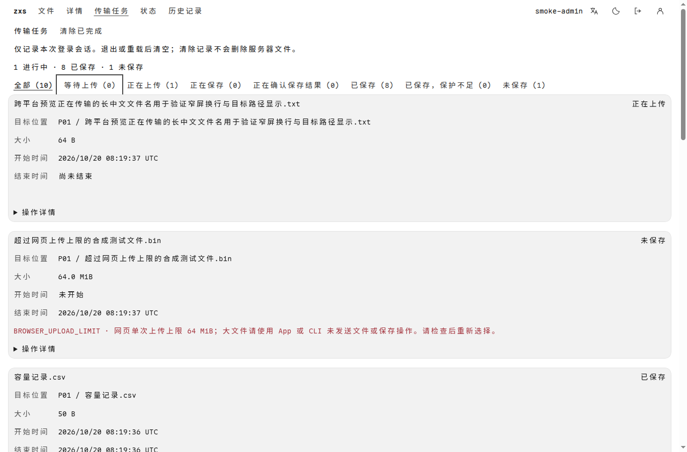
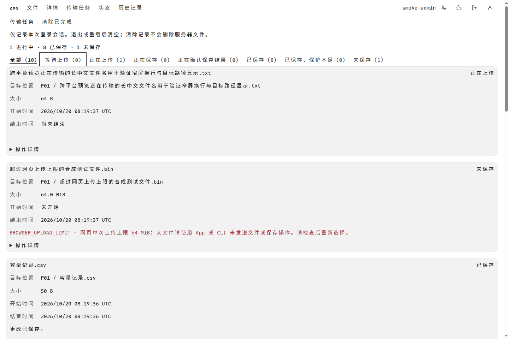
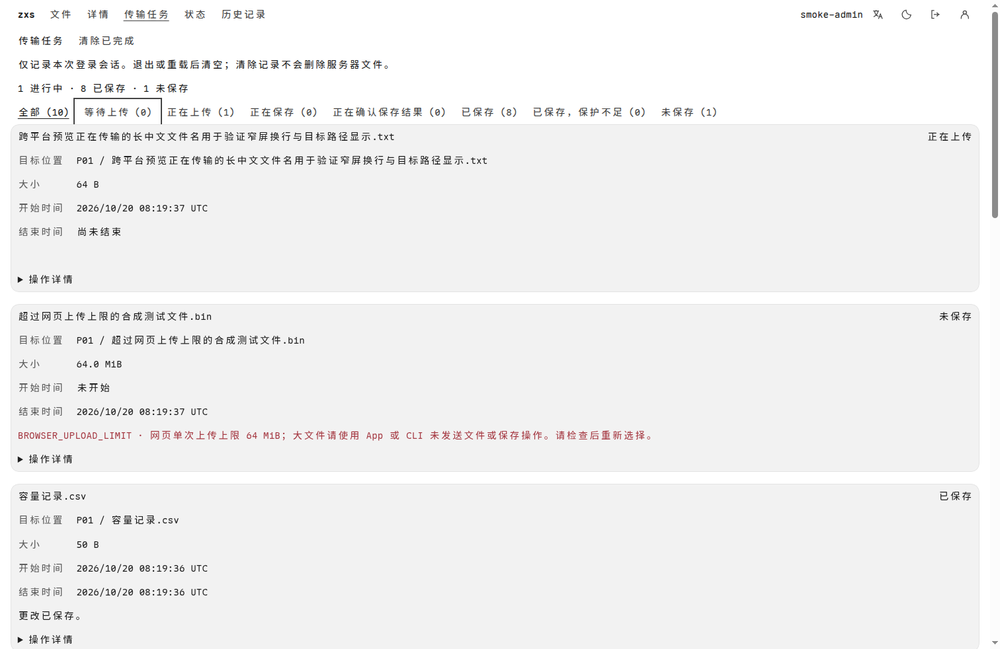
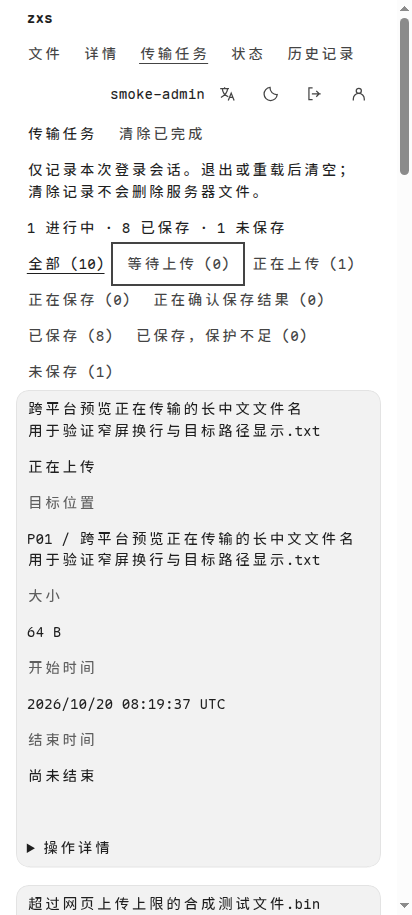
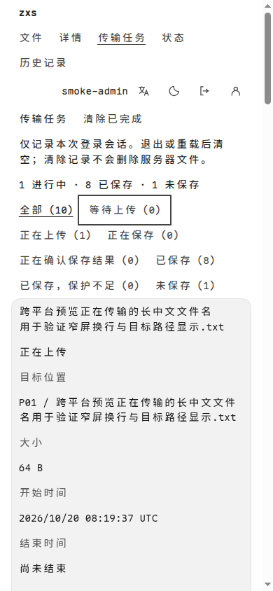
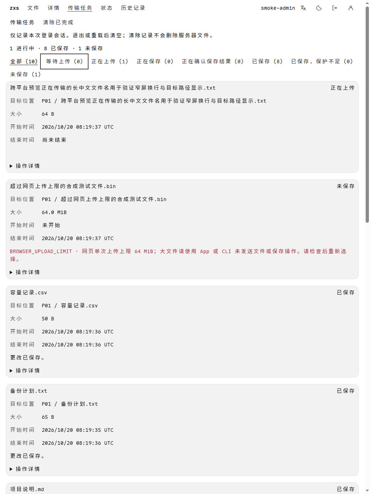

# 六平台尺寸的传输任务页面预览

以下均为真实 Chrome 渲染的共享生产 WASM 界面，不是六种操作系统或原生 WebView 的实机截图。使用真实临时服务和合成文件：上传中、已保存、预检失败均来自实际流程；只延迟原上传响应交付以捕获进行中状态。

源代码：[`422961a`](https://github.com/isarmg/zxs/commit/422961af1c83e146140a6831aa83159113be8a8e)；[CI 12 项成功](https://github.com/isarmg/zxs/actions/runs/39392146582)；[来源与校验值](source.json)。六种视口均通过横向溢出、操作控件与键盘焦点检查。手机页面可正常纵向滚动查看全部任务。

任务仅记录本次登录会话，退出或重载后清空；清除记录不删除服务器文件。移动提供方与设备验收边界见[平台矩阵](../../design/app-platform-matrix.md)。

## Linux · 1366 × 900

## Windows · 1440 × 960

## macOS · 1512 × 982

## Android · 412 × 915

## iOS · 390 × 844

## iPadOS · 1024 × 1366

