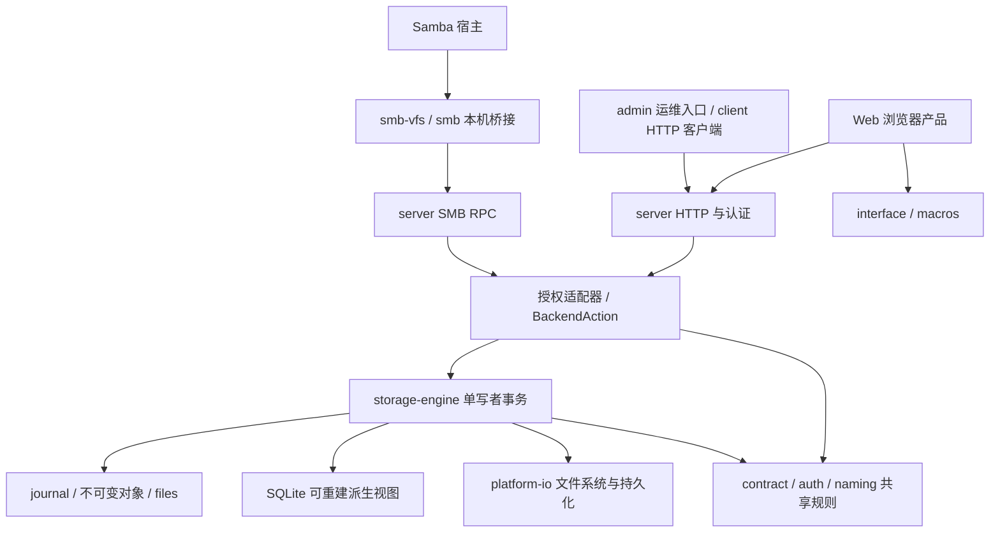

# zxs 架构与本轮改造说明

本报告说明当前代码的职责边界、本轮修复及其验证范围。产品入口为 Web 与 SMB，原生产品和构建宿主仅维护 Linux amd64；Web 必需的 `wasm32-unknown-unknown` 另行保留。架构核对基线为 `3f3841df0f129e49ac2467d05ecd768239e90c59`；本文件随后补充 ring 收尾与 TLS 安全更新的精确验证状态。

本轮没有替换 SQLite、改变权威存储模型，也没有将源码裁剪描述为性能提升。旧审查报告保留当时事实；其中 App/Tauri、独立演示、其他原生平台及旧计数不能视为当前支持承诺。

## 一、模块与依赖边界

图示的是主要调用方向，不是完整 Cargo 依赖图。`admin` 还直接承担本机初始化和服务启动，不能理解为所有管理命令都经 HTTP。

- **契约与基础规则**：`contract` 定义业务类型、编码和错误约束；`auth` 提供共享认证算法；`naming` 统一路径、Unicode 规范化与名称比较。协议入口不应自行复制这些规则。
- **平台与引擎**：`platform` 封装 Linux 文件系统、同步持久化及数据库基础设施；`engine` 负责工作区、版本、分支、授权、幂等、发布、修复与恢复。业务变更在候选状态上组合，经统一发布路径生效。
- **协议适配**：`server` 承担 HTTP、账号会话、本机 SMB RPC 和引擎适配；`BackendAction` 收敛操作词汇，但不意味着全部 JSON 请求和响应已强类型化。HTTP 与 Samba 共享 engine，不是各自维护一套存储真相。
- **产品与运维**：`web` 是浏览器产品；`interface` 与 `macros` 支撑界面和生命周期；`client` 提供 HTTP 与完整性校验；`admin` 提供运维 CLI；`smb` 与 `smb-vfs` 隔离本机协议、描述符和 Samba SDK/FFI。
- **foundation**：本地维护的第三方实现供上述组件及构建、验证工具消费；不是另一套业务框架。源码身份、原始法律材料和本地改动分别登记。

根工作区现有 **21 个显式成员**，其中 ring 是基础库回归验证成员，**不属于 9 个默认业务成员**。成员数、默认构建集合、来源树数和最终链接代码量是不同指标。

入口：[组件索引](../components/README.md)、[根工作区](../../Cargo.toml)、[单仓库结构](../monorepo.md)。

## 二、存储真相与读写模型保持不变

权威数据仍由 journal、日志绑定的不可变对象与版本正文 files 构成。SQLite 是可重建派生视图，不能代替发布决定或作为绕过证明校验的恢复来源。`PREPARE` 不等于可见；候选、同步收据和发布屏障共同决定公开状态。

只读证据路径按日志绑定的精确摘要选择有效副本，不能以多数票替代摘要，也不在普通查询中偷偷修盘。显式恢复路径与只读观察分离。分支登记继续复用冻结父引用，真正写入才形成自己的正文版本。

元数据分页、对象前缀分片和精确序列化大小预检减少单对象容量风险，但不构成 O(delta) 写入：候选 State 克隆、历史遍历和完整投影仍可能随保留数据增长。不能由“分页”推出总内存恒定或吞吐提升。

源码：[engine 发布](../../src/engine/src/engine/publication.rs)、[索引](../../src/engine/src/engine/index.rs)、[发布证据](../../src/engine/src/publication_evidence.rs)、[元数据预检](../../src/engine/src/metadata_budget.rs)。

## 三、已落实的正确性与资源边界

### 账户撤权与读取临界区

账号禁用、降权和仓库准入变更发布到受保护的引擎认证快照。业务入口在 engine 锁内重新取得当前身份，上传及提交在锁外准备结束后再次检查；账号发布遵守 `auth → engine` 锁序，业务路径不反向获取认证锁。

操作结果查询先校验归属和当前仓库权限，再进行锁外健康 I/O，返回前重新加锁并复核授权。目录树在锁内捕获独立 DTO，锁外序列化；正文与校验表在锁内固定授权版本和读取计划，磁盘工作在锁外执行。读租约随计划及正文生命周期持有，防止读取目标被并发清理。这不是全量无锁读取，也不是可重用授权缓存。

已经取得的读计划不承诺在随后撤权时追回正在传输的字节；后续请求须重新准入。认证锁等待和密码、持久化等阻塞工作移出异步执行器，不以陈旧账号副本换取响应速度。

源码：[授权适配](../../src/server/src/engine_backend.rs)、[读取投影](../../src/server/src/engine_backend/read_projection.rs)、[内容计划](../../src/server/src/engine_backend/content.rs)、[操作授权](../../src/server/src/engine_backend/operations.rs)。

### 目录容量与原子性

目录分支选择按替换子树后的完整仓库树检查 `max_directory_entries`，而不是仅检查被选择子树。超限在发布前拒绝，不留下部分状态或消耗成功操作回执；释放额度后可按原操作 ID 重试。相关回归覆盖合并后超限、边界切换及重启恢复。

源码：[目录选择](../../src/engine/src/business/directory.rs)、[容量回归](../../src/engine/tests/directory_selection_limits.rs)。

### HTTP 上传预算、公平准入与时限

HTTP spool 在读取请求体前预留容量，按账号、全局额度及文件系统恢复保留空间准入。账本重建计入保留数据和未知文件；无法证明释放的空间不返还额度。元数据也有保守费用，零字节上传不能绕过容量限制。这是逻辑预算，不是磁盘实际分配块数的精确计量。

上传和读取使用独立并发池，默认各 8 个全局槽位、每账号 2 个；达到限制立即拒绝，不建立无限等待队列。这限制单账号独占，不承诺 FIFO 调度或恶意流量下的绝对公平。默认 idle 60 秒、total 3600 秒；计时器在接收方停止轮询正文时仍能释放流。正在执行的阻塞任务继续持有自己的 permit/lease，直到真实完成，不能因请求取消提前放入竞争写入。

新暂存文件由明确所有者清理；记录 rename 后转为已引用，后续目录 fsync 失败不能误删可能被接受的字节。同代际重试比对已持久前缀，旧代际和不确定恢复数据保守保留。

**此预算当前仅覆盖 HTTP spool，没有统一 HTTP、SMB 与 engine 的全局 spool 预算，也没有自动 GC 未知上传或通用崩溃孤儿文件。**

源码：[spool_budget](../../src/server/src/spool_budget.rs)、[transfer_limits](../../src/server/src/transfer_limits.rs)、[uploads](../../src/server/src/uploads.rs)、[传输](../../src/server/src/transfer.rs)。

### HTTP 错误与 SMB Close

HTTP 请求在响应开始前统一输出 `error.code/message/retryable/request_id`；路径、查询、请求体上限、404/405 和 Range 错误有明确边界。响应头发送后的内容流失败仍是传输错误，不能伪装成新的 JSON 错误响应。

SMB Close 正常尝试 Flush；失败仍移除本次句柄并释放路径占用，同时保留可恢复工作及错误，不返回虚假的保存成功。Detach 与 Abort 分离：前者保留未确认字节，不自动发布。直接写入 FD 可能先于 Dirty 通知，因此断连不能以“尚未收到 Dirty”为由删除工作副本。写打开还核对观察到的条目与固定基础提交，防止并发更新造成旧正文搭配新基础。

源码：[HTTP 边界](../../src/server/src/http_boundary.rs)、[SMB 发布与关闭](../../src/server/src/smb_rpc/publication.rs)、[关闭回归](../../src/server/src/smb_rpc/close_tests.rs)。背景见[协议审查](server-protocol-review-20261020.md)及[架构复核](architecture-followup-20261020.md)。

## 四、foundation 的维护与证据职责

原生维护范围是 Linux amd64，当前实际登记、构建与验收主目标为 `x86_64-unknown-linux-gnu`；必要 Web WASM 不是额外原生平台承诺。保留未来可能使用的 Linux API、共享 Unix/generic 实现、必要构建辅助和回归材料，不按当前默认 feature 或文件名机械删库。

已提交批次收敛了生成 UAPI、系统/网络后端和 runtime：mio 保留 epoll/poll/pipe 等 Linux 路径，parking 保留 Linux futex 及必要 Web 路径，memchr 保留 generic/x86_64/Web 实现，Tokio 保留未来 Linux 能力，getrandom 保留明确的 Linux 与 Web 熵源选择。共享文档壳及原始上游资料中的其他平台名称，不等于产品支持那些平台。

ring 已恢复可信上游测试材料与真实根工作区测试入口，并修复严格诊断暴露的少量等价风格问题。本报告随 ring Linux amd64 target 收尾提交，目标裁剪同时保留受限的历史校验材料，不将其作为活动构建输入。最终范围和结果以对应提交、[专项报告](ring-linux-amd64-target-20261020.md)及其 CI 为准。

来源管理分清四种职责：

1. **活动源码**描述当前实际维护、构建和测试的实现。
2. **原始来源、许可证及上游材料**保留原始身份和字节，裁剪不抹掉版权与来源。
3. **当前收据**记录活动文件摘要、显式退役／升级替换状态及真实消费者闭包；不能反向改写原始来源哈希。
4. **补充 proof**解释测试材料恢复、精确风格变换和目标裁剪等本地变化，可离线校验；对象哈希完整性不是额外上游数字签名，也不是密码认证。

相关材料：[来源治理](../tools/rust-sources.md)、[来源清单](../THIRD_PARTY_RUST_SOURCES.md)、[中央法律与来源](../../compliance/README.md)、[Linux 首批](linux-amd64-foundation-20261020.md)、[系统后端](linux-amd64-system-backends-20261020.md)、[runtime 收敛](linux-amd64-runtime-final-20261020.md)、[ring 测试恢复](ring-test-restoration-20261020.md)、[ring 诊断修复](ring-style-diagnostics-20261020.md)。

## 五、验证状态与明确未完成项

- 已推送提交 `5815ea78569719d80e25ab89484ede73bdae1880` 的[整合 CI 39478322686](https://github.com/isarmg/zxs/actions/runs/39478322686)全 13 项 success。这里的“已推送”不等于产品部署或发行。
- 最新 runtime 提交 `3f3841df0f129e49ac2467d05ecd768239e90c59` 的[CI 39480385599](https://github.com/isarmg/zxs/actions/runs/39480385599)已完成，全 13 项 success；这是该精确提交自身的通过状态，不是继承前一提交。
- ring target 收尾提交 `75a37e5921fc4c4318310f96d994c16a6e91f0ab` 的 [CI 39492595266](https://github.com/isarmg/zxs/actions/runs/39492595266) 已结束：12 项 success，安全门禁因新发布的 RUSTSEC-2026-0381／0382 失败；并非全绿。
- 随后的 [TLS 安全更新](../security/TLS_EMSIGN_2026.md) 将本地源码真实升级为 rustls-webpki 0.103.16 与 webpki-roots 1.0.10，保留旧来源收据。当前本地完整质量门禁、来源核验与 8 项 TLS 集成回归已通过；加固后真实在线审计的扫描器 405 个身份、产品锁 357 个身份及上游来源 341 个身份均无发现。整合 CI 仍以此次安全修复提交的 Checks 为准，不继承历史绿灯。
- 安全扫描工具另以固定 cargo-audit 0.22.2 官方源码和独立受控锁文件构建，修复其自身 TLS 验证依赖；锁文件、构建身份和二进制摘要共同约束缓存复用，扫描器自身依赖也纳入安全门禁。每次扫描使用独立严格配置，避免继承用户的 severity、yank 或 fetch 弱化选项；固定无色诊断，避免彩色日志掩盖扫描错误。它不是第二个产品工作区，也没有引入公告豁免。实现与构建边界见[工具说明](../../.github/security-tools/README.md)。
- 本轮 foundation 收敛未做性能基准、非 GNU ABI 验收、运行时 CPU 特征屏蔽矩阵或物理盘故障验收。历史受控调度探针与历史性能记录各有局限，不构成本轮端到端性能提升证据。
- 未完成真实物理设备掉电/拔盘、完整生产 Samba 客户端互操作验收；现有单测、SDK 构建和 CI 不能替代这些证据。具体已执行范围以每批报告和对应 CI 为准。
- 未将全部读路径改为无锁、全部业务载荷改为强类型，也未实现 O(delta) 全链路写入、未知上传自动 GC 或跨协议统一 spool 预算。

## 六、后续维护约束

保持单一当前格式与无数字版本的 `/api/`，不新增服务旧程序的兼容层，不建立人为 v1/v2 发布脚手架；当前格式的历史证明与恢复职责不能误删为“旧兼容”。本轮不改 G4 几何与绘制源代码。

后续修改应在具体职责边界内补充失败回归，保持严格编译诊断、离线来源核验和对应提交 CI。对外结论区分“源码保留”“编译成功”“测试执行”“真实环境验收”，不以目录减少、测试总数或历史绿灯替代当前证据。
