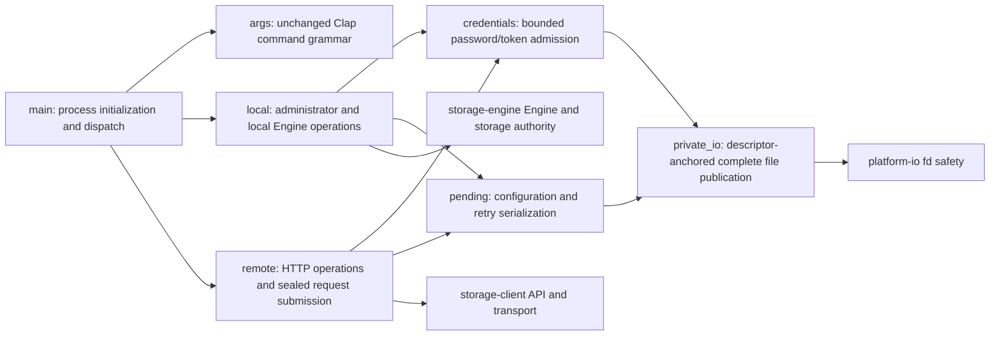

# CLI / internal CSR framework maintainability review

## Scope and method

This is the second delegated scope after the server/platform/shared-auth review recorded in the historical temporary test directory/log. Read the original 1,041-line CLI entry, its manifest and README, all 24 Rust source files plus two build scripts under `vendor/web`, and the manifests/module READMEs. The original vendor Rust scope was about 7,423 lines, including extensive API examples and generated-code tests/documentation.

Reviewed actual command dispatch, local/HTTP differences, credential and retry-file ownership, macro token generation, reactive ownership/cleanup and DOM mounting. No real `runtime`, user storage pool, secret file or existing service was opened or modified. CLI tests use temporary directories, randomly generated fixture credentials and one disposable loopback HTTP fixture; the independent Web framework fixture has no production route or product behavior.

## CLI structure after refactoring

The old main module combined argument grammar, all local and HTTP commands, credential checks and several subtly different private-file writers. The entry is now 38 lines; each concern has a named module. Local and remote command names, option grammar and business operation order remain compatible. Existing u64 output intended for JSON wire/display now consistently uses decimal strings for login expiry and topology generation. There is no new storage format or migration.

### CLI findings and implemented corrections

1. **Password files were not actually private; token checks inspected a different path lookup from the read.** A previous password `read_to_string` did not check ownership/mode and neither input was bounded before allocation. Token `symlink_metadata` followed by a second `read_to_string` allowed rebinding between validation and use. The shared `private_io` resolves the caller-selected parent once, holds its directory descriptor, opens the leaf through platform `openat2` restrictions, rejects non-regular/multilink/symlink targets, and validates the exact opened descriptor. Secret files must belong to the current effective UID and be mode 0400 or 0600; executable and special permission bits are rejected. Password input is bounded at 1,024 bytes plus at most two trailing newline bytes; token input is bounded by its canonical encoding plus two. Standard input is bounded before validation too.
2. **Private writers could leave empty/partial visible files or overwrite through inconsistent paths.** Token, configuration output and retry JSON now serialize first, exclusively create a random sibling 0600 staging inode, write and sync it completely, publish with `RENAME_NOREPLACE`, then sync the held parent directory. Existing files, directories and symlinks win. Failure removes the staging name created by that operation. The cleanup guard is armed only after exclusive creation and is disarmed immediately after a successful rename, before parent sync, so a reused temporary name cannot be removed during guard destruction. Parent-directory sync failure preserves the existing `PublishedDurabilityUnknown` distinction and the published destination.
3. **Private output code was duplicated across command paths.** One descriptor-based primitive now serves credentials, JSON output, retry files and explicit configuration-draft replacement. Configuration replacement only accepts an existing owned regular single-linked file and publishes a complete replacement; backup creation is no-clobber, while an existing owned backup retains the command's previous replacement behavior. The caller-selected output parent may be a public existing directory such as `/tmp`; privacy is enforced on the created file. This intentionally avoids an incompatible requirement that every output parent be mode 0700.
4. **Pending request directories were created/adjusted with weaker independent logic.** `pending` now uses platform `PrivateDirectory`: an existing directory with wrong ownership/mode or a symlink is rejected rather than silently repaired. The operation identifier is validated before choosing the filename. Existing request JSON is never replaced, preserving explicit retry behavior.
5. **Login could leak a newly issued usable session when saving its token failed.** If token publication fails (for example, the caller supplied an already occupied output path), the command now attempts logout of exactly the newly created session before returning the original file error. A real disposable loopback HTTP regression verifies login then logout and preserves the existing output bytes. Revocation is best effort: transport failure during this cleanup cannot promise immediate server-side invalidation; the original error remains the user-visible cause.
6. **Large integers were printed as JSON numbers in small output adapters.** Login expiry and local topology generation are decimal strings. A `u64::MAX` regression verifies exact login output and verifies that neither token nor CSRF is included in the output object/text.
7. **Malformed configuration could panic on `level + 1`.** Register-disk now uses checked level arithmetic. A draft containing `u32::MAX` upstream level returns an error without changing the draft or creating a backup. Reading the draft once also ensures that the saved backup exactly matches the parsed source, rather than reading a second potentially changed source file. A real temporary four-disk draft test verifies valid registration, exact original backup bytes and complete updated JSON.
8. **Unsafe init password should fail before creating storage state.** A regression verifies that a mode-0644 password fixture is rejected before any requested pool/system/development-disk directory is initialized.

### CLI file coverage

| File | Reviewed responsibility / result |
| --- | --- |
| `crates/storage-admin/Cargo.toml` | Existing dependencies, new reuse of `platform-io` and `rustix`; `tempfile` only for regression fixtures. |
| `crates/storage-admin/README.md` | Commands, local/remote trust boundaries, private secret files, retry persistence; updated responsibility map and actual file guarantees. |
| `src/args.rs` | Entire unchanged Clap grammar extracted from original entry; global flags and all local/remote command variants. |
| `src/main.rs` | Process logging, JSON output helper, operation ID helper and local/remote dispatch only. |
| `src/local.rs` | Initialization/auth ordering; serve setup; configuration generation/registration; local Engine commands; export/restore/maintenance/plan paths; checked level and complete draft publication corrections. |
| `src/remote.rs` | Login/logout/account paths; query/upload/download; sealed commit and explicit retry; namespace and history/plan operations; consistent expiry output and login rollback. Previously compressed match arms formatted into reviewable statements. |
| `src/credentials.rs` | Shared bounded private password/token reads, canonical token admission and no-clobber token output. |
| `src/pending.rs` | JSON serialization before creation, operation ID check, private retry directory and immutable request publication. |
| `src/private_io.rs` | Directory descriptor lifetime, opened-inode checks, permissions/owner/single-link policy, exclusive temporary ownership, atomic no-clobber and explicit replacement publication, cleanup and durability errors. |

## Internal CSR framework findings and implemented corrections

1. **Attribute ordering comparator did not define an order.** The view macro used a comparator in which comparing `class` to `style` could return `Less` in both directions, and tuple additions could return `Greater` in both directions. This violates the sort contract. Replaced it with stable explicit priorities: basic class/style first, ordinary values second, tuple additions last. Source order within each priority and the first spread boundary remain intact. Real RSX token-generation regressions cover mixed class/style/base/additions/spread and 96 alternating tuple additions.
2. **Filtering spread blocks shifted component prop boundaries.** Component-builder code removed block attributes and then enumerated the shortened list, but compared that index to the original list's explicit props/spread boundary. A prefix attribute block could make an HTML attribute enter the typed component PropsBuilder. Preserve original indices before filtering. The regression renders `<Widget {..extra} value=3 {..} title="html-attribute" />` and verifies that `value` remains a component prop while `title` is an HTML attribute.
3. **Mutable children conversion rejected genuinely mutable closures.** `ToChildren` for `ChildrenFnMut` incorrectly required `Fn`. It now requires `FnMut` and invokes the captured closure mutably. A native regression captures mutable local state, invokes the children closure twice and observes both mutations; the old bound cannot compile that case.
4. **Repeated false notifications orphaned an AnimatedShow timeout.** A second false notification replaced the stored timeout handle without clearing the first. A later show only cleared the most recent handle, allowing the earlier timeout to hide visible children or execute after unmount. Every condition notification now clears the previous handle before scheduling or showing. Scoped cleanup still clears the current handle on unmount. `AnimatedShow` is not currently used by the business application; this fixes the shared component's exposed behavior rather than claiming it caused a current application page defect.

### Vendor file coverage

| File(s), under `vendor/web` | Reviewed responsibility / result |
| --- | --- |
| root/core/macro READMEs and both Cargo manifests | Internal facade/dependency naming, active CSR features and upstream origin; directed native regression command documented. |
| `web-interface-core/build.rs`, `view-macros/build.rs` | Build cfg and feature gating; retained. |
| `core/src/lib.rs` | Public exports and feature gates; current business is CSR. |
| `core/src/animated_show.rs` | Condition scheduling and cleanup; timeout ownership bug corrected and independently exercised in browser. |
| `core/src/attribute_interceptor.rs` | Attribute capture/forwarding and child view construction; no demonstrated defect found. |
| `core/src/children.rs` | Once/repeated/mutable children conversions, owner-scoped children and optional variants; FnMut bound corrected. |
| `core/src/component.rs` | Component trait/adapters and owner context; no demonstrated defect found. |
| `core/src/for_loop.rs` | Keyed iteration and owner capture; no demonstrated defect found. |
| `core/src/from_form_data.rs` | One-line residual module; no active form parsing implementation. |
| `core/src/into_view.rs` | View conversion, debug markers and attributes; no demonstrated defect found. |
| `core/src/mount.rs` | Mount/unmount handle lifetime, owner disposal and body/element mounting; used by the independent browser fixture. |
| `core/src/portal.rs` | External DOM mount and cleanup ownership; no demonstrated defect found. |
| `core/src/provider.rs` | Context owner lifetime and child rendering; no demonstrated defect found. |
| `core/src/show.rs` | Memoized simple conditional branch; no demonstrated defect found. |
| `core/src/show_let.rs` | Option/result branching, memo context and child ownership; no demonstrated defect found. |
| `core/src/text_prop.rs` | Static/dynamic text conversion and optional conversions; no demonstrated defect found. |
| `macro/src/lib.rs` | Public macro entry points, argument parsing, server/island-related residual feature paths and generated runtime naming; no arbitrary source execution added. |
| `macro/src/component.rs` | Props parsing/building, defaults, generics/lifetimes, doc generation, component body rewriting and generated identifiers; retained beyond targeted view defects. |
| `macro/src/diagnostics.rs` | Structured compile diagnostics; retained. |
| `macro/src/memo.rs`, `macro/src/slice.rs` | Typed memo/slice AST parsing and closures; no demonstrated defect found. |
| `macro/src/slot.rs` | Slot props/defaults/children generation and diagnostics; no demonstrated defect found. |
| `macro/src/view/mod.rs` | HTML/component/fragment token generation, attrs/spread, namespaces, event/property/directive branches, text/escaping and view markers; stable attribute ordering corrected. |
| `macro/src/view/component_builder.rs` | Typed prop boundary and attribute forwarding; original-index boundary correction. |
| `macro/src/view/slot_helper.rs` | Named/default slots, duplicate handling and slot child collection; no demonstrated defect found. |
| `macro/src/view/utils.rs` | Tag-to-runtime naming and HTML/SVG/MathML helper lookups; retained. |

In this table, `core/src` abbreviates `web-interface-core/src` and `macro/src` abbreviates `view-macros/src`. No vendor code was deleted solely because an inactive upstream-compatible generic/feature path was not used by today's product. No unverified new framework behavior was added to production pages.

## Verification and evidence

### CLI

- `cargo test --locked --offline -p storage-admin`: final host run passed **15 tests**, zero failures/ignored and no warnings; the historical temporary test directory/log. Host syscall access was needed only for disposable loopback TCP and root ownership fixture operations, not real service access.
- The tests cover private-file ownership and 0400/0600 modes; symlink/hardlink/non-file rejection; byte limits; held parent after path rebinding; atomic no-clobber output and cleanup; exactly one concurrent writer winning with complete content; success cleanup preserving a reused temporary name; explicit draft replacement; strict pending directory policy; exact configuration backup; overflow failure with no writes; unsafe init input with no storage initialization; expiry precision and secret-free output; failed token publication revoking its own new fixture session.
- `cargo fmt -p storage-admin --check`: passed.
- `cargo check --locked --offline -p storage-admin`: passed, no warnings.

### Vendor native tests

- `cargo test --locked --offline --manifest-path web/Cargo.toml -p web-interface-core -p view-macros --lib`: **4 passed** (one actual mutable children closure, three RSX macro token-generation regressions), zero failures/ignored and no warnings; the historical temporary test directory/log.
- The four changed vendor files were individually rustfmt checked/formatted; no mass formatting of unrelated vendor source.

### Independent actual Rust/WASM browser regression

- Created and built the historical temporary test directory/log, with Rust source importing the current runtime and changed vendor component, its own WASM module and generated JS bindings. No production route or application behavior was changed for the fixture.
- Fixture WASM loaded HTTP 200 as `application/wasm`, SHA-256 `6def2bfe3e5220efaa2cdf0dfd7593939b86ad1818a8689c375c391b92044725`.
- Browser sequence one: hide at 0.8 ms, repeated false notification at 51.7 ms, show at 102.2 ms; at 352.4 ms the child remained present, beyond both previous hide deadlines.
- Browser sequence two: hide, repeated false notification, unmount; after 305.2 ms the mount target had zero children, empty text and no child element.
- Both sequences passed with empty `pageErrors` and `consoleErrors`. Durable sanitized evidence is `tests/evidence/maintainability/animated-show-probe.mjs` and `animated-show-result.json`. The Web reviewer executed the probe and closed its disposable HTTP server. It did not access the user's current service.

## Remaining boundaries

- Register-disk remains an offline administrator operation on a configuration draft. Atomic complete file replacement prevents partial data; it does not add multi-process optimistic locking or merge concurrent independent edits. The README already requires stopping the process that owns the pool for local administration.
- Secret input rules intentionally become stricter to match the documented private-file contract; an old mode-0644 password/token file must be explicitly corrected by its owner rather than silently accepted or chmod-repaired by this program.
- Best-effort logout after token publication failure cannot guarantee revocation if the network has already failed. No real account or secret was used to test this path.
- Native macro token regressions plus the actual Rust/WASM timer fixture establish the specific corrected paths. They do not claim exhaustive fuzzing of arbitrary Rust macro syntax, inactive SSR/hydration/island features, or a cross-browser matrix of every generic component.
- This agent did not perform production deployment, physical-device power-loss testing, native six-platform packaging, or final whole-repository acceptance. Root owns the combined workspace build/test and Web application acceptance.
